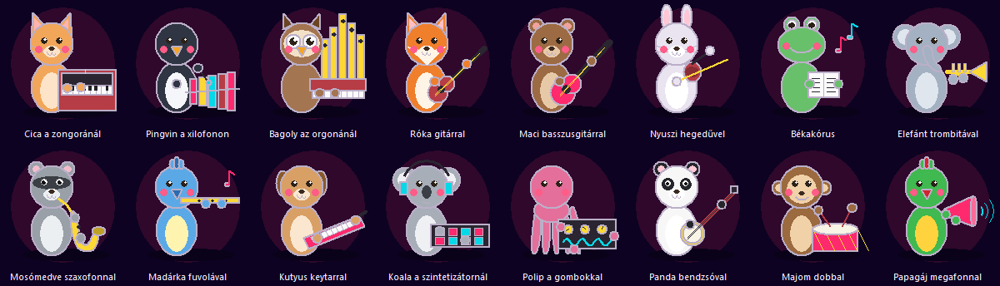
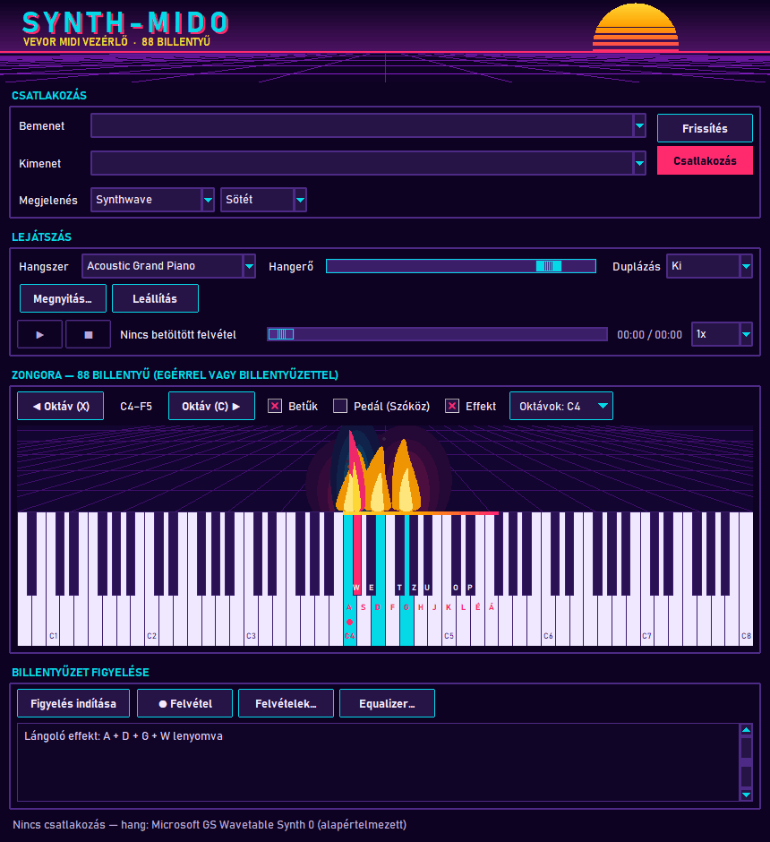
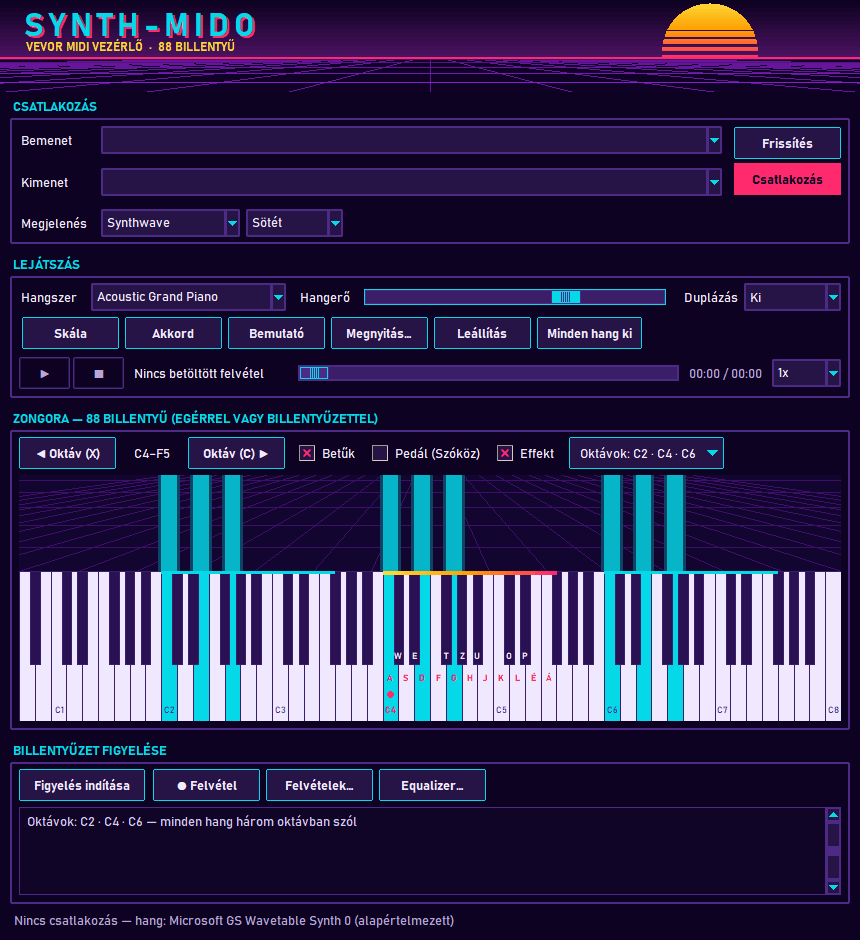
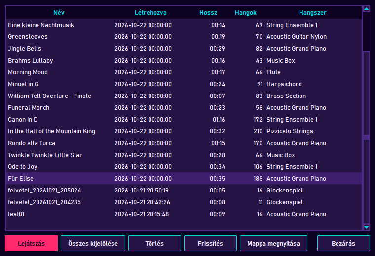

# Haladás

Feladatonként egy oldal képernyőképpel; a legújabb van legfelül.

| Feladat | Tartalom | Kép |
|---|---|---|
| [TASK-022](task-022.md) | Hangszer illusztráció (16 állat a hangszerével) |  |
| [TASK-020](task-020.md) | Lángoló hangeffekt |  |
| [TASK-019](task-019.md) | Rájátszás: a felvétel mindent rögzít, 2. verziójú formátum |  |
| [TASK-018](task-018.md) | Hibakereső gombok eltávolítása | — |
| [TASK-017](task-017.md) | Többoktávos játék (Oktávok) |  |
| TASK-016 | Groma architektúra térkép rendezése (`groma/`) | — |
| [TASK-015](task-015.md) | Daloskönyv: 18 közkincs mű felvételként |  |
| [TASK-014](task-014.md) | Winamp-szerű hangszínszabályzó ablak |  |
| [TASK-013](task-013.md) | Skin rendszer: 17 skin × sötét / világos |  |
| [TASK-012](task-012.md) | Refaktorálás csomagokba (Observer, Facade, Strategy) | architektúra ábra |
| [TASK-011](task-011.md) | Oktáv duplázás ("két kéz") |  |
| [TASK-010](task-010.md) | Synthwave hangvizualizáció |  |
| [TASK-009](task-009.md) | Synthwave dizájn |  |
| [TASK-008.04](task-008-04.md) | Kitartó pedál (Szóköz) |  |
| [TASK-008.03](task-008-03.md) | Oktávváltás és betűk a billentyűkön |  |
| [TASK-008.02](task-008-02.md) | Zongorázás a számítógép billentyűzetével |  |
| [TASK-008.01](task-008-01.md) | 88 billentyűs zongora (A0–C8) |  |
| [TASK-006](task-006.md) | Lejátszó vezérlők: szünet, sebesség, pozíció csúszka |  |
