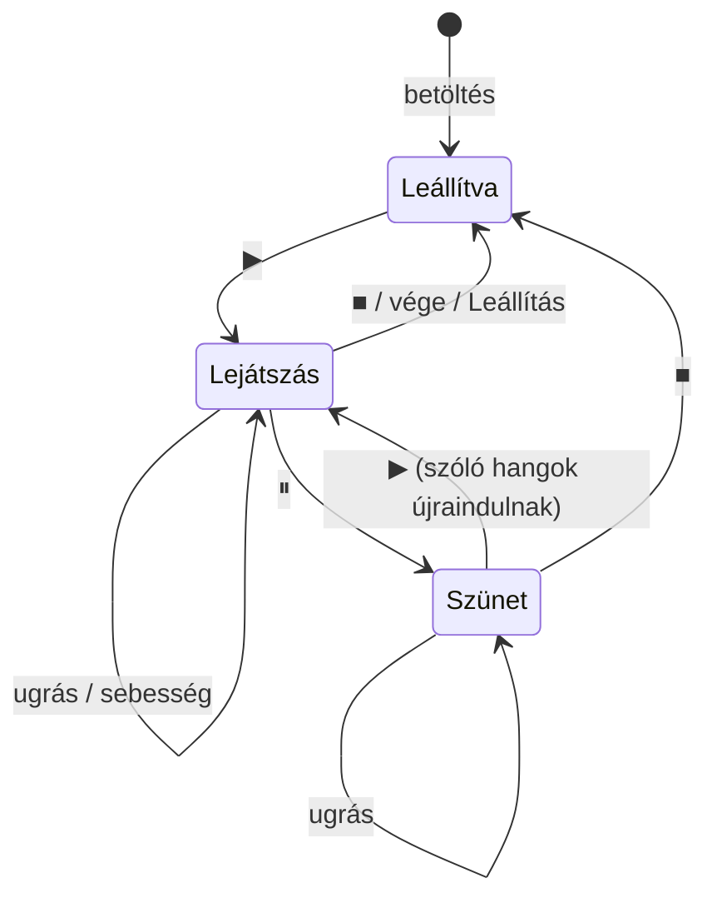

# TASK-006 — Lejátszó vezérlők (szünet, sebesség, pozíció csúszka)

**Állapot:** kész · 2026-10-21

## Mi változott

| Terület | Változás |
|---|---|
| `playback.py` | A `Player` kis "transport" lett: lejátszás / szünet / leállítás, `seek()`, `set_speed()`, `position()`. A hangok szakaszként (`build_spans`) is megmaradnak, így folytatáskor és ugráskor újraindulnak az épp szóló hangok. |
| `ui.py` | Új lejátszó sor a "Lejátszás" részben: ▶/⏸, ■, felvétel neve, pozíció csúszka (kattintás / húzás → ugrás elengedéskor), `mm:ss / mm:ss`, sebesség (0.5x–2x). Felvétel nélkül le van tiltva. Állapotsor: *Lejátszás* / *Szünet*. |
| `test_playback.py` | +11 teszt: szünet/folytatás, ugrás tartott hang közepébe, ugrás szünetben, sebességváltás pozícióugrás nélkül, leállítás, újrajátszás a végéről. |
| `readme.md` | "Lejátszó vezérlők" szakasz. |

## Működés

## Ellenőrzés

- 28 lejátszó unit teszt zöld (hamis órával és időzítővel).
- Valós ablak, MIDI eszköz nélkül: 19/19 ellenőrzés (letiltott vezérlők betöltés előtt, mozgó csúszka, szünet némít, ugrás kattintással, 2x sebesség, leállítás visszateker, a végéről újraindul, bemutató ↔ felvétel kölcsönösen leállítja egymást).
