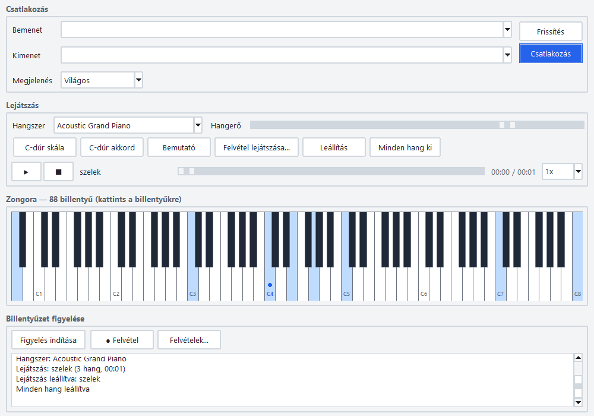
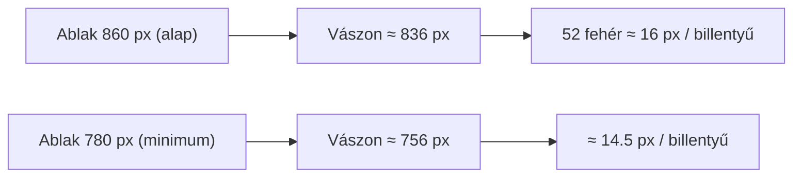

# TASK-008.01 — 88 billentyűs zongora (A0–C8)

**Állapot:** kész · 2026-10-21

| Sötét téma | Világos téma |
|---|---|
|  |  |

A képeken kiemelve: A0, C3, C4 (középső C, kék pöttyel jelölve), E4, G4, C5, C7, C8 — a teljes tartomány minden része kiemelhető.

## Mi változott

| Terület | Változás |
|---|---|
| `piano_layout.py` (új) | Tk-tól független geometria: 88 billentyű (MIDI 21–108), `is_black`, `note_label`, `layout(width, height)` (52 fehér egyenletesen, 36 fekete a fehérek határán), `key_at(x, y)` (a fekete van felül). |
| `ui.py` | A zongora a teljes 88 billentyűt rajzolja, ablakméretre skálázódik (görgetés nélkül). Csak a C-k feliratosak (C1…C8), a középső C kiemelt színnel és ponttal. |
| `test_piano_layout.py` (új) | 11 teszt: darabszám, tartomány végei, minta, hézagmentes fehérek, fekete billentyűk helye, `key_at`, skálázás, minden billentyű kattintható a minimális szélességen. |

## Méretek

## Ellenőrzés

- 11 geometria unit teszt zöld.
- Valós ablak: 21/21 ellenőrzés — 88 billentyű alap és minimális szélességen, egérrel A0 / A#0 / B0 / C4 / C#4 / B7 / C8 kiválasztható és megszólaltatható, lejátszás kiemeli az A0 / A1 / C8 hangot, mindkét témában újrarajzol.
