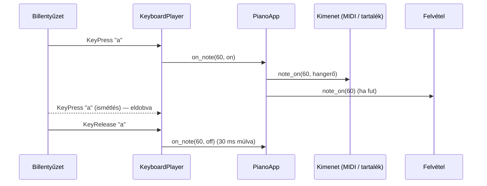

# TASK-008.02 — Zongorázás a számítógép billentyűzetével

**Állapot:** kész · 2026-10-21


## Kiosztás

```
   W   E       T   Z/Y  U       O   P
 A   S   D   F   G    H   J   K   L   É/;  Á/'
 C4  D4  E4  F4  G4   A4  B4  C5  D5  E5   F5
```

18 hang (C4–F5), magyar QWERTZ és amerikai QWERTY kiosztáson ugyanazokon a fizikai gombokon.

## Mi változott

| Terület | Változás |
|---|---|
| `keyboard_play.py` (új) | `KEYMAP` (Tk keysym → félhang), `note_for()`, `KeyboardPlayer`: lenyomott gombok követése, Windows és X11 billentyűismétlés szűrése, hang megjegyzése lenyomáskor (oktávváltásnál sem marad lógó hang), `release_all()`. |
| `ui.py` | Ablak szintű KeyPress / KeyRelease; szövegmezőben, legördülőben és Ctrl / Alt mellett nem szól; legördülő választás után a fókusz visszakerül; fókuszvesztéskor minden hang elengedve. Egér és billentyűzet közös útvonalon: kimenet + felvétel + kiemelés. |
| `test_keyboard_play.py` (új) | 16 teszt: mindkét kiosztás, karakter-keysym (é / á), ismétlés két platformon, akkord, tartomány széle, `release_all`. |



## Ellenőrzés

- 16 unit teszt zöld.
- Valós ablak, generált billentyű eseményekkel: 12/12 — hangerő a csúszkából, ismétlés nem indít újra, magyar gombok (z, é) akkordban, legördülőben és Ctrl-lal nem szól, választás után a fókusz visszajön, felvétel rögzít, fókuszvesztés elenged.
- Talált és javított hiba: ezen a Tk verzión az `é` / `á` keysym maga a karakter, nem `eacute` / `aacute` — mindkettő támogatott.
