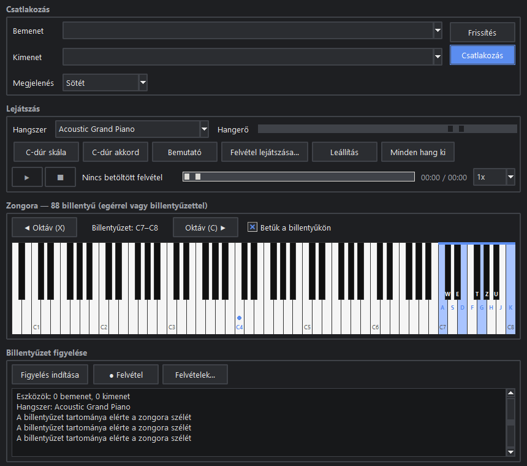
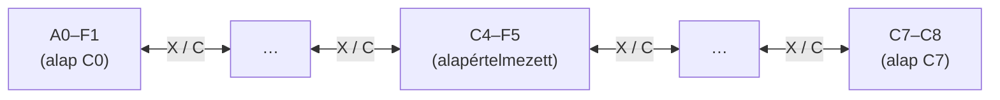

# TASK-008.03 — Oktávváltás és betűk a billentyűkön

**Állapot:** kész · 2026-10-21

| Legalsó tartomány (A0–F1), H = A0 lenyomva | Legfelső tartomány (C7–C8), K = C8 lenyomva |
|---|---|
|  |  |

## Mi változott

| Terület | Változás |
|---|---|
| `keyboard_play.py` | **X** = oktáv le, **C** = oktáv fel (mindkét kiosztáson ugyanott, nem szólnak, nyomva tartva nem ismételnek). `shift()` a C0…C7 alaphang között (így az A0 és a C8 is elérhető), `range_notes()`, `key_labels()` (magyar QWERTZ betűk). |
| `ui.py` | Új sor a zongora felett: ◀ Oktáv (X), "Billentyűzet: C4–F5", Oktáv (C) ▶, "Betűk a billentyűkön" kapcsoló. A vásznon kék sáv jelzi az elérhető tartományt, a billentyűkön a betűk. Az ablak alapmérete 860×760 (minimum 780×660), hogy a napló látszódjon. |
| `test_keyboard_play.py` | +7 teszt: alapértelmezett tartomány, X/C, ismétlés nélkül, hangok eltolódnak, A0 / C8 határ, lenyomott hang eltolás után is elenged, betűk. |

## Ellenőrzés

- 23 billentyűzet unit teszt zöld.
- Valós ablak: 12/12 — alapértelmezett C4–F5, X kétszer → C2–F3, eltolás közben lenyomott hang rendben elenged, alul A0–F1 (H = A0), felül C7–C8 (K = C8), a széleken túl nem lép, betűk ki- és bekapcsolhatók.
