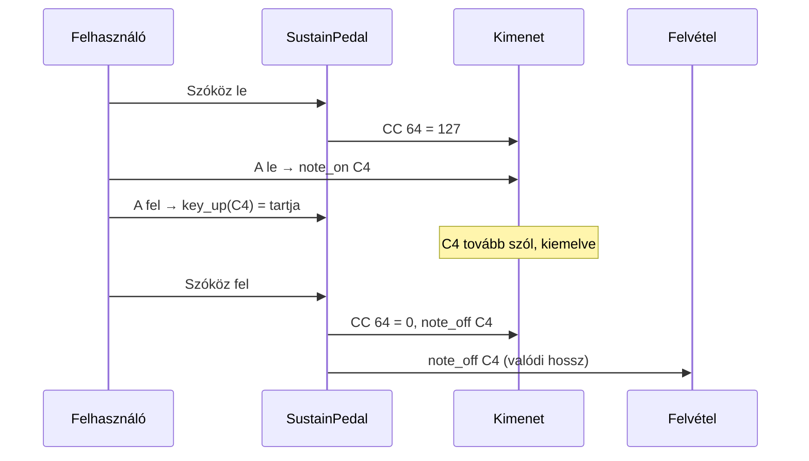

# TASK-008.04 — Kitartó pedál (Szóköz)

**Állapot:** kész · 2026-10-21

## Mi változott

| Terület | Változás |
|---|---|
| `sustain.py` (új) | `SustainPedal`: lenyomott pedálnál az elengedett billentyűk hangja tovább szól, a pedál felengedésekor leállnak. Újra lenyomott hangot már a billentyű tartja. |
| `keyboard_play.py` | **Szóköz** = pedál; ismétlés (Windows és X11) szűrve, `release_all` a pedált is felengedi. |
| `midi_controller.py` | `sustain(on)`: MIDI CC 64 (127 / 0) az aktív kimenetre. |
| `ui.py` | Egér és billentyűzet hangjai a pedálon át állnak le; a kitartott hang kiemelve marad, a felvétel a valóban szóló hosszt rögzíti. "Pedál (Szóköz)" kapcsoló (egérrel rögzíthető). A főablak gombjain a Szóköz pedál (nem kattint), a párbeszédablakokban marad a megszokott gombnyomás. Fókuszvesztés, Leállítás, Minden hang ki és kilépés felengedi. |
| `test_sustain.py` (új) | 10 teszt: pedál logika, Szóköz ismétlés, CC 64. |

## Ellenőrzés

- 10 pedál unit teszt zöld.
- Valós ablak: 12/12 — Szóköz pedál, elengedett hang tovább szól, ismétlés nem engedi fel, a felvétel a kitartott hosszt rögzíti, egérrel rögzített pedál, Szóköz a főablak gombján pedál, párbeszédablakban kattint, Leállítás és fókuszvesztés felengedi.
