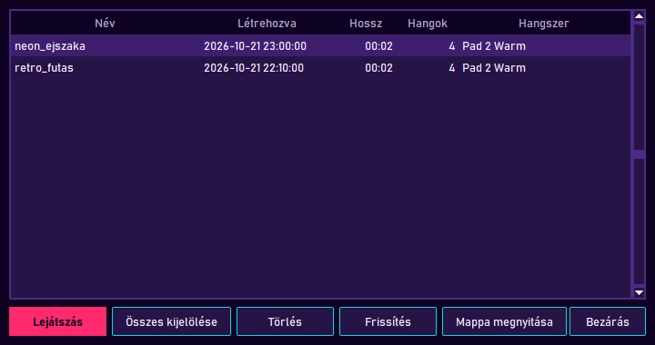
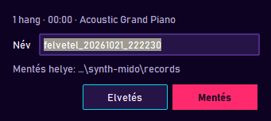
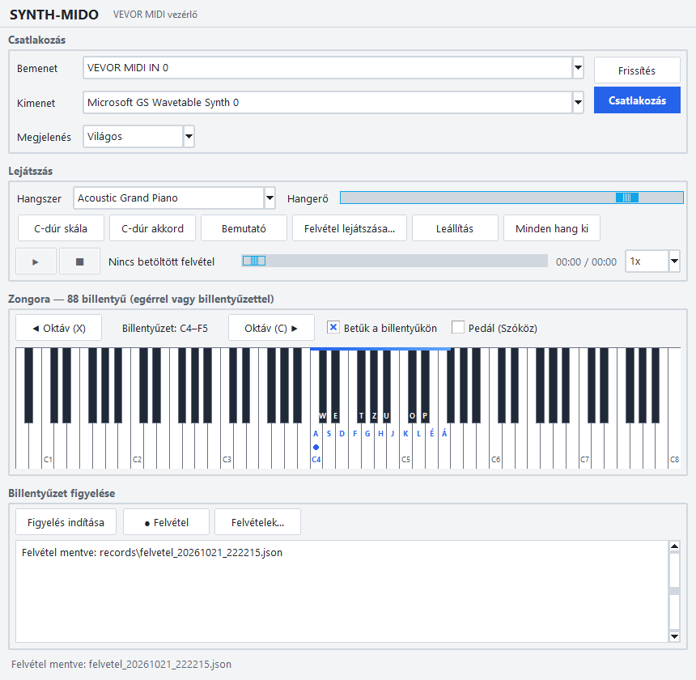

# TASK-009 — Synthwave dizájn

**Állapot:** kész · 2026-10-21

| Felvételek ablak | Mentés párbeszéd | Összehasonlítás: Világos téma |
|---|---|---|
|  |  |  |

## Dizájn sablon

| Token | Szín | Szerep |
|---|---|---|
| `bg` | `#0d0221` | éjszakai égbolt — ablak háttér |
| `surface` | `#261447` | mezők, gombok |
| `border` | `#4d2a85` | keretek |
| `accent` | `#ff2a6d` | neon magenta — elsődleges gombok, fekete billentyű kiemelés, horizont |
| `accent2` | `#05d9e8` | neon cián — szakaszcímek, gomb keretek, csúszkák, fehér billentyű kiemelés |
| `sun_top` → `sun_mid` → `sun_bottom` | `#fdd835` → `#ff9e00` → `#ff2a6d` | naplemente: nap, tartomány sáv |
| `grid` | `#b026ff` | perspektivikus rács |
| `fg` / `muted` | `#f5e9ff` / `#b8a6d9` | szöveg |

- Betűtípus: **Bahnschrift** (Windows 10+), különben Segoe UI / DejaVu Sans — nincs letöltött betűtípus.
- Elsődleges gomb: magenta háttér, sötét felirat (kontraszt 5.5 : 1). Másodlagos gomb: sötét háttér, cián keret, fölé vitt egérnél magenta keret.
- Minden szöveg/háttér pár legalább 4.5 : 1 kontrasztú (unit teszt ellenőrzi).

## Mi változott

| Terület | Változás |
|---|---|
| `theme.py` | `SYNTHWAVE` paletta és mód (**alapértelmezett**, a TASK-003 "Rendszer" alapértelmezését váltja; mentett választás megmarad). Új közös tokenek minden palettában (`accent2`, `section_fg`, `header_bg`, `title_fg`, `sun_*`, `grid`). `display_font()`, `contrast()` (WCAG), `mix()`. |
| `ui.py` | Fejléc vászon: Synthwave-ben csíkos naplemente nap, horizont, perspektivikus rács, ritkított neon cím magenta árnyékkal; a többi témában egyszerű címsor. Nagybetűs neon szakaszcímek, lapos neon keretes gombok, cián csúszkák, naplemente színátmenetű tartomány sáv. |
| `test_theme.py` | +7 teszt: paletta kulcsok, megadott tokenek, kontraszt ≥ 4.5, új alapértelmezés, mentett "Rendszer" tiszteletben tartva, `mix`, betűtípus választás. |

### Mellékesen javított hiba

Az állapotsor (alul) az alapértelmezett ablakméretnél **eddig sem látszott**: a napló 10 sornyi magasságot kért, ezért az utoljára elhelyezett állapotsor kiszorult (a korábbi képeken is hiányzik). Most az állapotsor kap először helyet, a napló kitölti a maradékot.

## Ellenőrzés

- 23 téma unit teszt zöld.
- Valós ablak: 19/19 — friss beállításnál Synthwave, nagybetűs címek, fejléc rajzolva, billentyűk és napló színei, felvételek ablak és mentés párbeszéd témázva, mentés működik, mind a négy téma között futás közben váltás maradék színek nélkül, választás mentve, állapotsor és zongora látszik alap és minimális méretnél.
