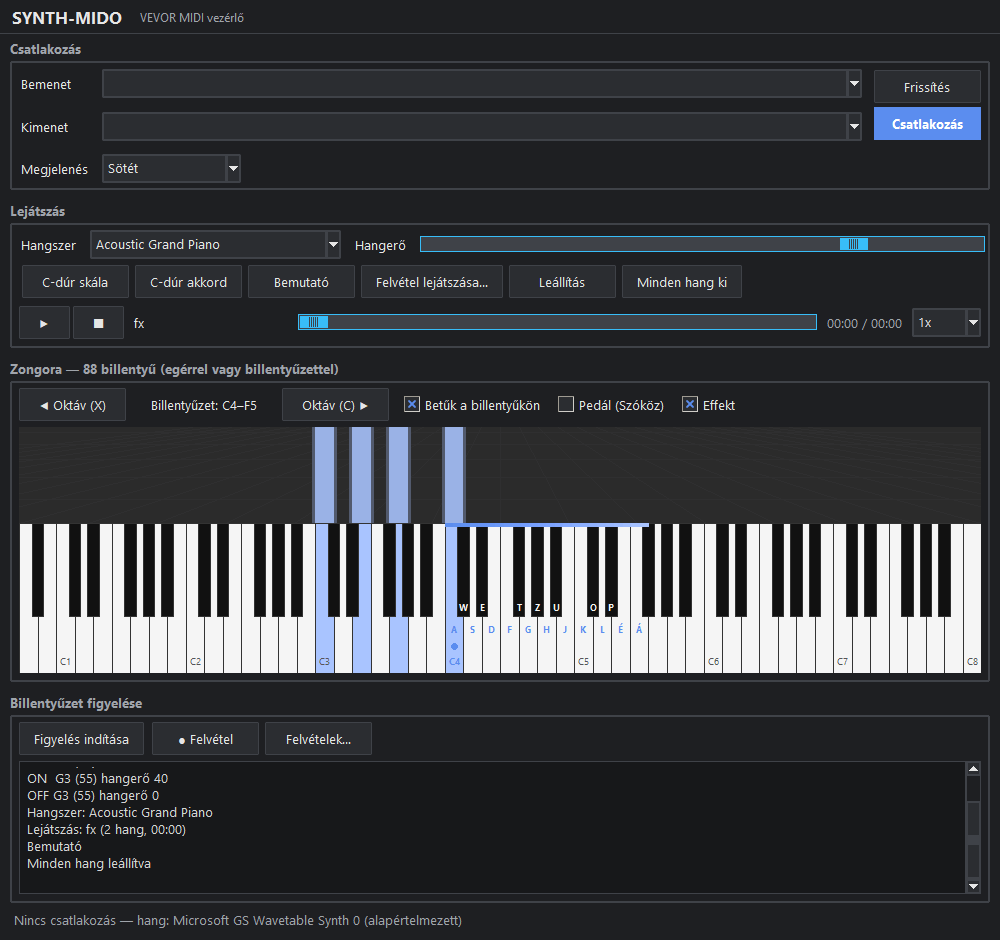
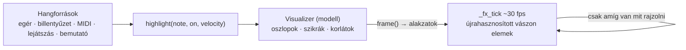

# TASK-010 — Synthwave hangvizualizáció

**Állapot:** kész · 2026-10-21

| Sötét témában (akcentus színek) |
|---|
|  |

## Működés

- A zongora feletti sávban minden szóló hang neon oszlopot növeszt a saját billentyűje fölé (fehér billentyű: cián, fekete: magenta; a többi témában az akcentus színek). A fényerő a hangerőtől függ, a szóló oszlop körül halvány "ragyogás".
- Elengedéskor az oszlop leválik, tovább emelkedik és 1.6 mp alatt elhalványul (csóva); hangindításkor szikrák pattannak.
- Minden hangforrás: egér, számítógép billentyűzet (oktávváltással, pedállal), MIDI bemenet, felvétel lejátszás, bemutató gombok — mind a `highlight()`-on át érkezik.
- **Effekt** kapcsoló a zongora feletti sorban; a választás mentődik (`visual_fx`).

## Teljesítmény

| Lépés | Mérés |
|---|---|
| Első változat (minden képkockán törlés + létrehozás, 160 oszlop / 120 szikra) | ~20 ms / képkocka sűrű játéknál |
| Elemek újrahasznosítása | ~17 ms — a szűk keresztmetszet a vászon újrarajzolása (~22 ms / 284 elem) |
| Szigorúbb korlát (96 oszlop, 60 szikra, 3 szikra / hang) + adaptív képkocka idő | **~12.7 ms** extrém terhelésnél (300 hangos sorozat) |

A ciklus csak addig fut, amíg van látható elem; ha egy képkocka mégis lassú, a következő később jön, hogy a hangok időzítése ne sérüljön.

## Ellenőrzés

- 17 vizualizáció + beállítás unit teszt zöld.
- Valós ablak: 15/15 — minden hangforrás, pedál alatt szóló oszlop, felengedésre leválik, a ciklus leáll üresjáratban, sűrű játéknál < 15 ms / képkocka, minimális méretnél is skálázódik, kikapcsolva rejtve és mentve, újraindításkor emlékszik.
