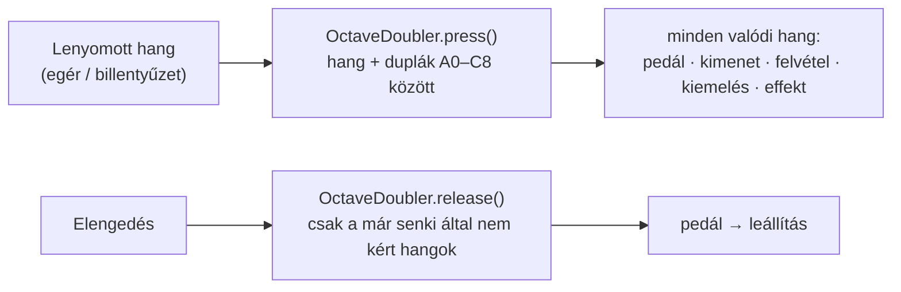

# TASK-011 — Oktáv duplázás ("két kéz")

**Állapot:** kész · 2026-10-21

## Működés

A "Lejátszás" sorban a **Duplázás** választó: **Ki** (alapértelmezett), **+1 oktáv**, **−1 oktáv**, **±1 oktáv**. Bekapcsolva minden egérrel vagy billentyűzettel játszott hanghoz ugyanaz a hang egy oktávval (8 billentyűvel, 12 félhanggal) lejjebb / feljebb is megszól — ugyanazzal a hangerővel, kiemeléssel, vizuális effekttel, a pedál is tartja, és a felvétel is rögzíti (a visszajátszás ugyanúgy szól). A választás mentődik.

A MIDI bemenet (a zongora a saját hangján szól) és a felvétel visszajátszás **nem** duplázódik.

| Eset | Viselkedés |
|---|---|
| C4 (+1 → C5) lenyomva, közben C5 is | a közös C5 addig szól, amíg bármelyik billentyű lenyomva van |
| Beállítás váltása lenyomott billentyű mellett | elengedéskor pontosan a lenyomáskor indított hangok állnak le |
| A0 −1 oktávval | a 88 billentyűn kívüli dupla csendben kimarad |

## Mi változott

| Terület | Változás |
|---|---|
| `doubling.py` (új) | `targets()`, `OctaveDoubler` (lenyomásonként megjegyzett hangok + hivatkozásszámlálás), magyar feliratok. |
| `ui.py` | Egér és billentyűzet hangjai a duplázón át mennek; "Duplázás" választó, mentés (`octave_doubling`). |
| `test_doubling.py` (új) | 9 teszt: irányok, tartomány szélei, közös hang, váltás lenyomva, ismételt lenyomás. |

## Ellenőrzés

- 9 unit teszt zöld.
- Valós ablak: 17/17 — Ki / ±1 / +1 / −1, azonos hangerő, kiemelés + effekt, közös hang, váltás lenyomva, A0 széle, pedál, felvétel tartalmazza a duplát, MIDI bemenet és lejátszás nem duplázódik, mentés és visszatöltés.
