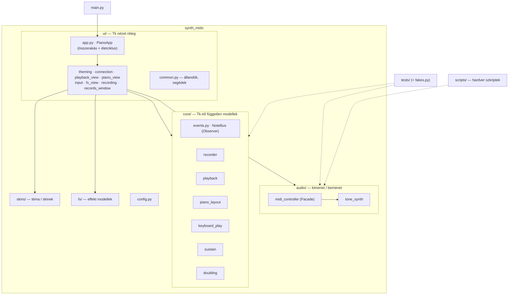
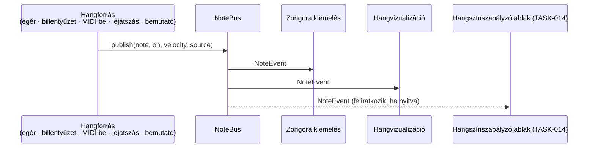

# TASK-012 — Refaktorálás csomagokba, tervezési mintákkal

**Állapot:** kész · 2026-10-21 · viselkedés változatlan (159 + 4 unit teszt, a korábbi ablak tesztek ugyanazt adják)

## Új felépítés

## Observer: NoteBus

## Mi változott

| Előtte | Utána |
|---|---|
| 17 modul a gyökérben, `ui.py` ~1400 sor | `synth_mido/` csomag: `core/`, `audio/`, `skins/`, `fx/`, `ui/`; a gyökérben csak `main.py` |
| `ui.py` mindent csinál | `ui/app.py` (~300 sor) + 8 fókuszált mixin modul + `common.py` |
| `highlight()` közvetlenül hívja a vizualizációt | `NoteBus.publish()` → feliratkozók (kiemelés, vizualizáció) — forrás címkével (`user`, `midi_in`, `playback`, `demo`) |
| tesztek a gyökérben, egymást importálják | `tests/` + `tests/fakes.py` (közös hamis időzítő / port / hanggenerátor) |
| `test_midi.py`, `diag.py`, `examples.py`, `usb.py` a gyökérben | `scripts/` (`test_midi.py` → `scripts/midi_check.py`, mert nem unit teszt) |
| pre-commit modul lista | `python -m unittest discover -s tests -t .` |

Fájlmozgatás `git mv`-vel, így az előzmények megmaradnak.
