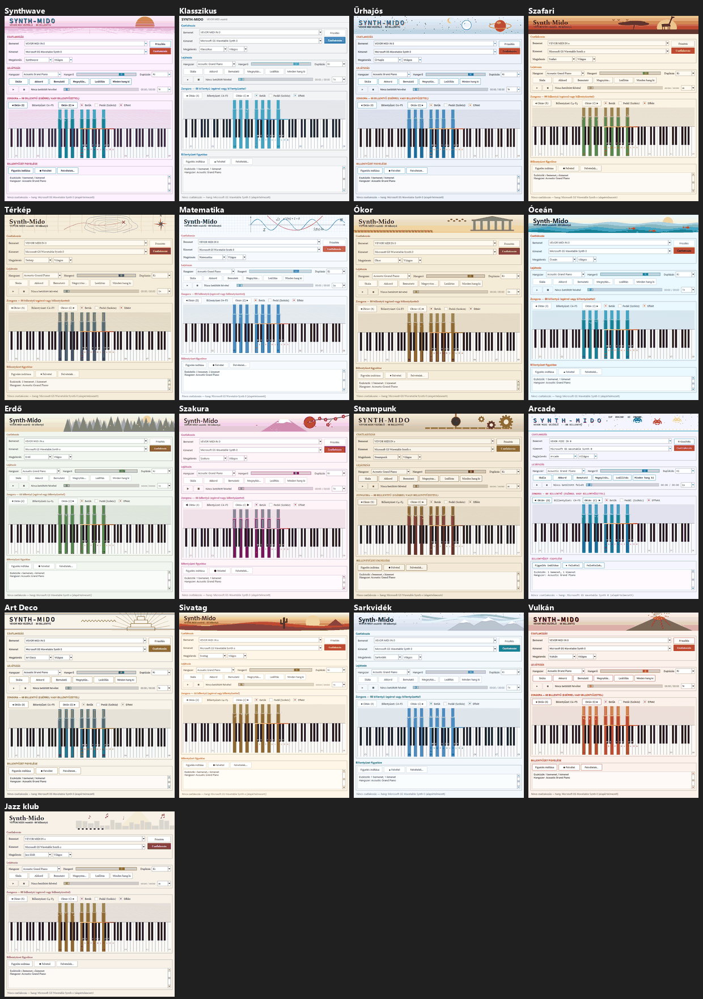
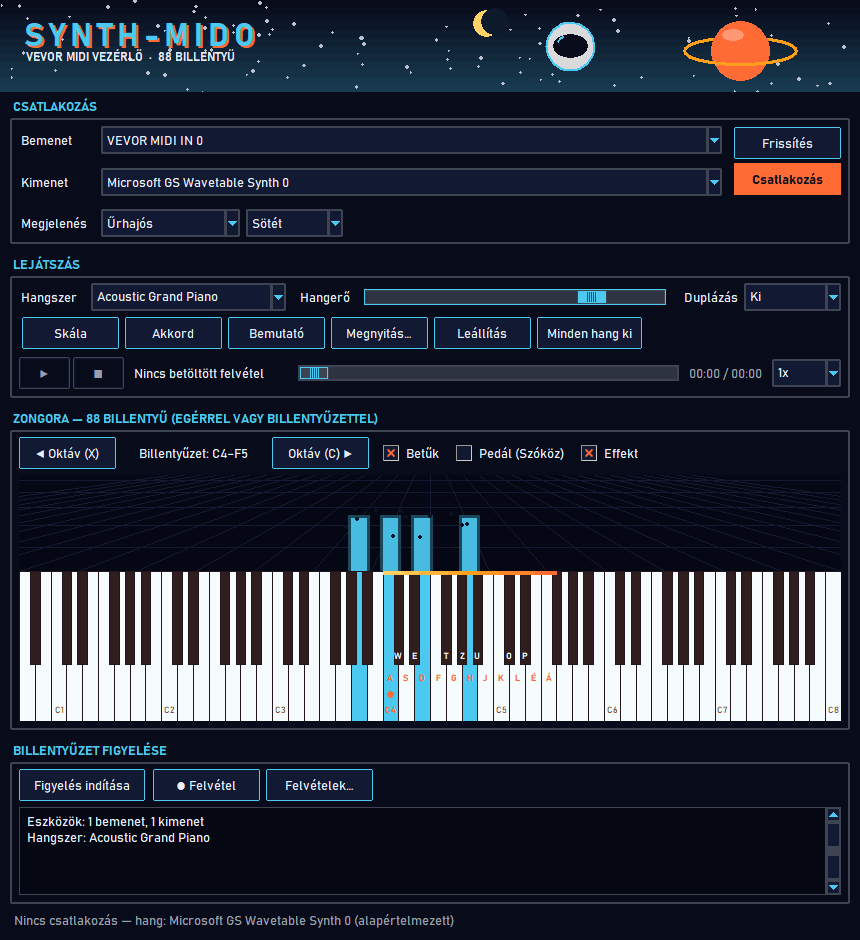
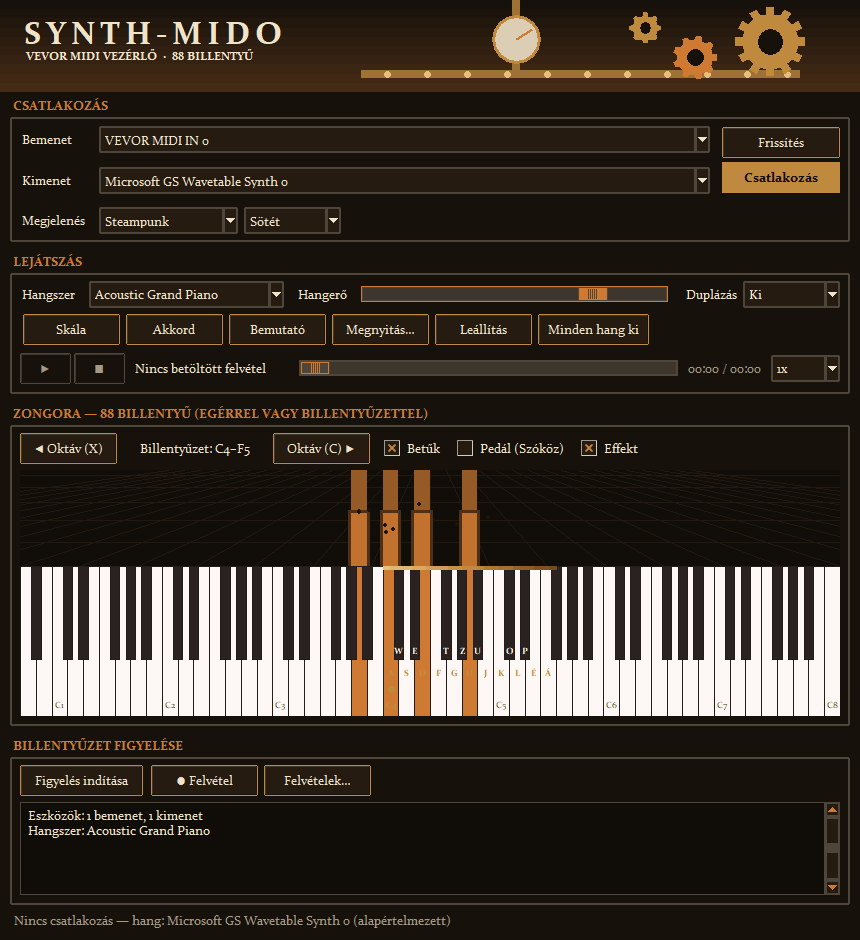
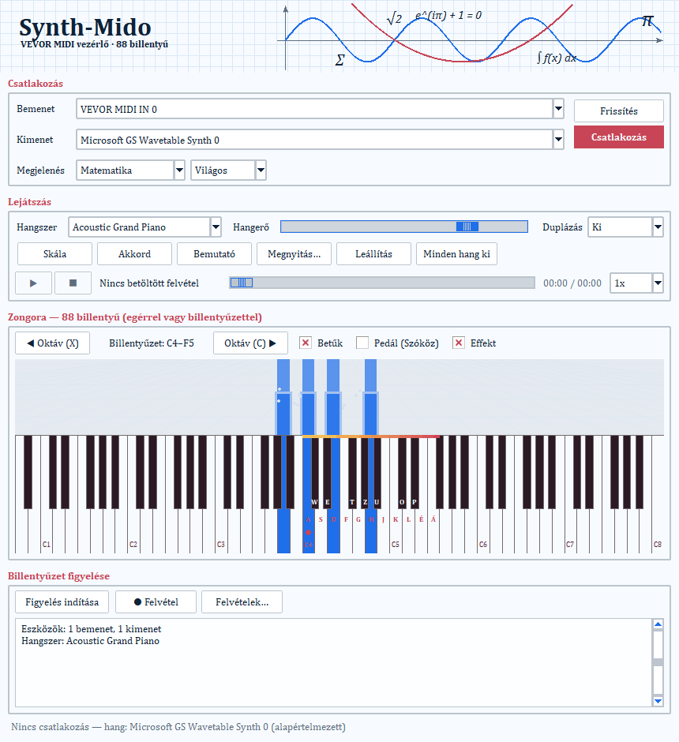
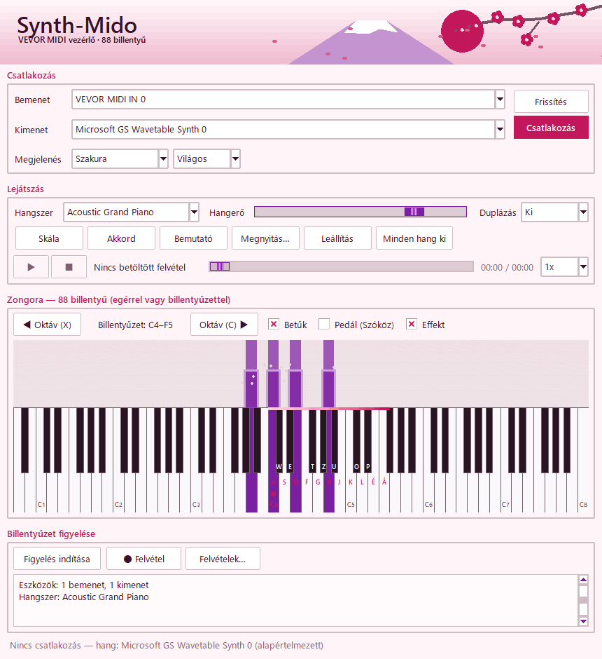
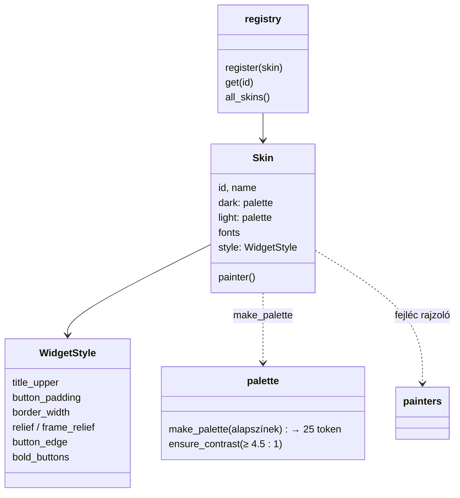

# TASK-013 — Skin rendszer: Synthwave alapértelmezés + 15 új skin, sötét és világos változattal

**Állapot:** kész · 2026-10-21

## Galéria — 17 skin × 2 változat (34 megjelenés)

**Sötét változatok**

**Világos változatok**

| Űrhajós · sötét | Steampunk · sötét |
|---|---|
|  |  |
| **Matematika · világos** | **Szakura · világos** |
|  |  |

## A skinek

| Skin | Fejléc jelenet | Betűtípus | Widget alak |
|---|---|---|---|
| Synthwave | csíkos naplemente nap, perspektivikus neon rács | Bahnschrift | neon cián keret, NAGYBETŰS címek |
| Klasszikus | egyszerű címsor (a régi Világos / Sötét) | Segoe UI | alap |
| Űrhajós | csillagok, gyűrűs bolygó, sisak, holdsarló | Bahnschrift | cián keret, NAGYBETŰ |
| Szafari | naplemente, akácfa, zsiráf, madarak | Constantia | domború gombok |
| Térkép | hosszúsági körök, szintvonalak, útvonal ✕, szélrózsa | Palatino | vésett keretek |
| Matematika | milliméterpapír, tengelyek, szinusz, parabola, képletek | Cambria | tömör gombok |
| Ókor | görög templom, meander, babérág | Palatino | vésett, 2 px keret |
| Óceán | hullámrétegek, halak, buborékok | Segoe UI | alap |
| Erdő | fenyősorok mélységgel, szentjánosbogarak | Candara | alap |
| Szakura | Fuji, vörös nap, virágzó ág, szirmok | Yu Gothic UI | alap |
| Steampunk | fogaskerekek, csövek szegecsekkel, nyomásmérő | Constantia | bordás 2 px réz keret, NAGYBETŰ |
| Arcade | pixel űrlények, pontszám, pixel csillagok | Consolas | 2 px neon keret, félkövér, NAGYBETŰ |
| Art Deco | napsugár legyező, zikkurat, arany vonalak | Bahnschrift | széles arany keretes gombok |
| Sivatag | dűnék, kaktusz, piramis, nap | Candara | alap |
| Sarkvidék | sarki fény, hósapkás hegyek, csillagok | Segoe UI | alap |
| Vulkán | vulkán, láva, füst, parázs | Bahnschrift | akcentus keret, NAGYBETŰ |
| Jazz klub | reflektor, városi sziluett, hangjegyek, billentyű csík | Constantia | domború gombok |

## Felépítés (Registry + Strategy)

- **Megjelenés**: skin választó + **Sötét / Világos / Rendszer** változat (a Rendszer az OS-t követi, futás közben is).
- **Synthwave alapértelmezés**: új beállítás kulcs (`skin`, `skin_variant`) — a régi `theme` érték már nem írja felül, így mindenki a Synthwave-vel indul.
- **Minden widget a skinből**: gombok (alak, keret, dombormű, minden állapot színe), csúszkák, jelölőnégyzetek, legördülők, görgetősávok, napló, felvételek ablak, mentés párbeszéd, zongora, tartomány sáv, effekt; skin váltáskor minden nyitott ablak újrastílusoz.

## Talált és javított hibák

- A clam téma `flat` reliefnél semmilyen keretet nem rajzol — a lapos skinek `raised` reliefet kapnak felülettel azonos fény / árnyék színnel.
- Széles betűtípusú skineknél (Georgia) a gombsorok kilógtak 780–860 px-nél: rövidebb feliratok (Skála, Akkord, Megnyitás…, Betűk), tömör `Small.TButton` stílus a zsúfolt sorokban, keskenyebb serif (Constantia). Mérés: mind a 34 megjelenés minden sora elfér alap és minimális szélességnél.

## Ellenőrzés

- 167 unit teszt zöld (új: `test_skins` — 17 skin, minden paletta minden tokenje és kontrasztja, minden fejléc rajzoló két méretben, stílus tokenek; `test_theme` — régi beállítás nem írja felül a Synthwave-et).
- Valós ablak: 17/17 (választás legördülőből, mentés, minden állapot színe, nagybetűs címek skinenként, nyitott felvételek ablak és mentés párbeszéd újrastílusoz, Rendszer változat, újraindítás); a korábbi ablak tesztek eredménye változatlan.
