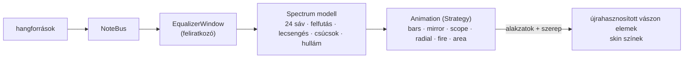

# TASK-014 — Winamp-szerű hangszínszabályzó ablak

**Állapot:** kész · 2026-10-21

## Működés

- **Equalizer…** gomb a "Billentyűzet figyelése" sorban: külön, átméretezhető ablak (újra megnyomva az ablakot hozza előre).
- 6 választható animáció: **Klasszikus oszlopok** (LED szegmensek, lehulló csúcsjelzők), **Tükrözött oszlopok**, **Oszcilloszkóp**, **Kör spektrum**, **Tűz**, **Spektrum görbe**. A választás mentődik.
- Nincs hangfolyam FFT-hez, ezért a spektrumot a hangok adják: minden hang a hangmagassága szerinti sávot táplálja (szomszéd sávok és az oktávval feljebbi "felhang" gyengébben), akkordoknál összeadódik; gyors felfutás, lassú lecsengés, a csúcsjelző kitart, majd lehull.
- Minden hangforrásra reagál (NoteBus feliratkozó): egér, billentyűzet, MIDI bemenet, lejátszás, bemutató.
- A színek a skinből jönnek (low = `accent2`, mid = `sun_mid`, high = `accent`, csúcs = `title_fg`), skin váltáskor azonnal újrastílusoz.

## Teljesítmény

- ~30 képkocka / mp, csak amíg az ablak nyitva van és van mozgás; csendben leáll, a következő hang újraindítja.
- Vászon elemek újrahasznosítása; a LED rács statikus réteg (a klasszikus oszlopok sávonként csak 3 téglalapból állnak).
- Mérés: **6.3 ms / képkocka** 44 egyszerre szóló hanggal.

## Ellenőrzés

- 14 unit teszt (sávok, felfutás, kitartás, lecsengés, csúcs tartás / esés, hullám, mind a 6 animáció a vásznon belül, korlátos elemszám).
- Valós ablak: 23/23 — megnyitás / újra előtérbe, NoteBus feliratkozás, minden hangforrás, leállás csendben és újraindulás, mind a 6 animáció, mentett választás, teljesítmény, skin váltás, a főablak gombsora minden skinnél elfér, bezáráskor leiratkozik.
