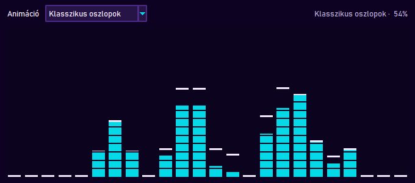
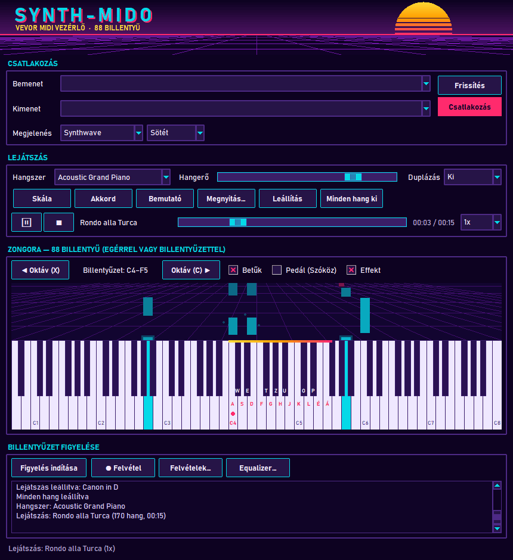
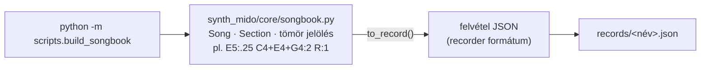

# TASK-015 — Daloskönyv: közismert közkincs művek felvételként

**Állapot:** kész · 2026-10-21

| Felvételek ablak a 18 dallal | Rondo alla Turca lejátszás közben, Equalizer-rel |
|---|---|
|  |  |

## A dalok (`records/`)

| Mű | Szerző | Év | Hangszer | Hossz | Hangok |
|---|---|---|---|---|---|
| Für Elise | Ludwig van Beethoven | 1810 | Acoustic Grand Piano | 00:35 | 188 |
| Ode to Joy | Ludwig van Beethoven | 1824 | String Ensemble 1 | 00:34 | 106 |
| Twinkle Twinkle Little Star | népdal (Mozart variációk) | 1761 | Music Box | 00:28 | 66 |
| Rondo alla Turca | Wolfgang Amadeus Mozart | 1783 | Acoustic Grand Piano | 00:15 | 170 |
| In the Hall of the Mountain King | Edvard Grieg | 1875 | Pizzicato Strings | 00:32 | 210 |
| Canon in D | Johann Pachelbel | 1680 | String Ensemble 1 | 01:16 | 172 |
| Funeral March | Frédéric Chopin | 1839 | Acoustic Grand Piano | 00:23 | 58 |
| William Tell Overture - Finale | Gioachino Rossini | 1829 | Brass Section | 00:07 | 83 |
| Minuet in G | Christian Petzold | 1725 | Harpsichord | 00:24 | 91 |
| Morning Mood | Edvard Grieg | 1875 | Flute | 00:17 | 66 |
| Brahms Lullaby | Johannes Brahms | 1868 | Music Box | 00:16 | 43 |
| Jingle Bells | James Lord Pierpont | 1857 | Acoustic Grand Piano | 00:29 | 82 |
| Greensleeves | népdal (angol) | 1580 | Acoustic Guitar Nylon | 00:19 | 70 |
| Eine kleine Nachtmusik | Wolfgang Amadeus Mozart | 1787 | String Ensemble 1 | 00:14 | 69 |
| The Entertainer | Scott Joplin | 1902 | Honky Tonk Piano | 00:10 | 93 |
| Gymnopédie No. 1 | Erik Satie | 1888 | Electric Piano 1 | 00:25 | 50 |
| Toccata and Fugue in D minor | Johann Sebastian Bach | 1705 | Church Organ | 00:27 | 41 |
| Moonlight Sonata | Ludwig van Beethoven | 1801 | Acoustic Grand Piano | 00:22 | 72 |

A felvételek a megszokott JSON formátumban vannak (csak hangok, időzítés, hangszer), így a **Felvételek…** ablakból vagy a **Megnyitás…** gombbal lejátszhatók, és a lejátszó vezérlők (szünet, sebesség, ugrás) is működnek.

## Szerzői jog

Csak **közkincs** művek: a szerzők több mint 70 éve hunytak el, vagy népdalok. Modern, védett művek — például az **Imperial March** (John Williams, 1980) — szándékosan nincsenek benne; a teszt is ellenőrzi.
A jegyben példaként szereplő Radetzky-indulót sem vettem fel, mert a dallamát nem tudtam volna kellő pontossággal lejegyezni; helyette Chopin Gyászindulója került be.

## Felépítés

- Jelölés: `hang:hossz` negyedhangban (`C4` = 60, `#` / `b`), akkord `+`-szal, szünet `R`, ütemvonal `|`.
- Szakaszonként saját tempó (a Hegyi király csarnokában gyorsul), a szólamok párhuzamosan; a teszt ellenőrzi, hogy egy szakasz szólamai ütemre pontosan együtt érnek véget.

## Ellenőrzés

- 9 unit teszt: jelölés, időzítés, ≥ 15 dal, egyedi és érvényes fájlnevek, nincs védett mű, minden dal érvényes felvétel a 88 billentyűn belül, értelmes hossz, szólamok igazítva, generálás + visszatöltés.
- A szólam-igazítás ellenőrzés 3 ritmushibát talált a lejegyzésben (Gyászinduló, Menüett, The Entertainer) — javítva.
- Valós ablak: 6/6 — mind a 18 dal a listában, a saját felvételek is megmaradtak, lejátszás a dal hangszerével, az Equalizer reagál.
