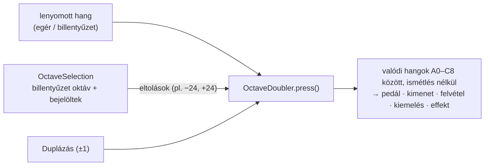

# TASK-017 — Többoktávos játék (Oktávok)

**Állapot:** kész · 2026-10-21

## Működés

- A zongora feletti sorban, az **Effekt** mellett: **Oktávok ▾** legördülő, C0 … C7 jelölőnégyzetekkel.
- Alapból csak a billentyűzet oktávja (amit az **X / C** állít) van bejelölve — minden úgy szól, mint eddig.
- További oktávokat bejelölve minden egérrel vagy billentyűzettel játszott hang **minden bejelölt oktávban** megszólal (azonos hangerővel), mintha több kéz játszaná.
- A billentyűzet oktávja nem vehető ki, és követi az X / C váltást; a többi bejelölés marad.
- A felirat mutatja a választást (pl. `Oktávok: C2 · C4 · C6`), a zongorán a további oktávok vékony cián jelölőt kapnak.
- Együtt működik a **Duplázás**-sal, a **pedállal** és a **felvétellel** (minden szóló hang rögzül); a MIDI bemenet és a visszajátszás nem sokszorozódik.

## Ellenőrzés

- +5 unit teszt (eltolások, ismétlés szűrése, tartomány, alapállapot, X / C követés, váltás lenyomva).
- Valós ablak: 19/19 — alapból egy hang, C2 · C4 · C6 billentyűzettel és egérrel, a billentyűzet oktávja nem vehető ki, X után C2 · C3 · C6, váltás lenyomva nem hagy lógó hangot, Duplázás + Oktávok együtt, pedál, felvétel, MIDI bemenet nem sokszorozódik, a sor minden skinnél elfér 780 px-en, a menü a skin színeit használja.
