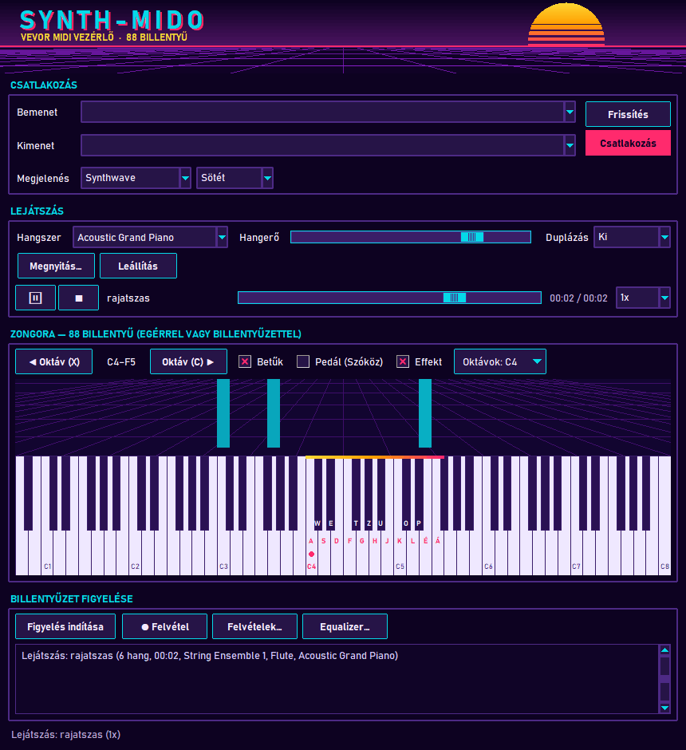
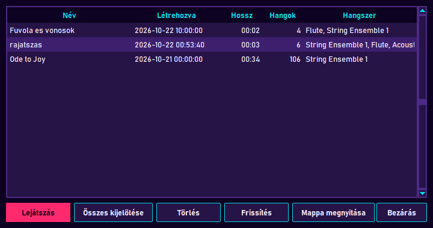
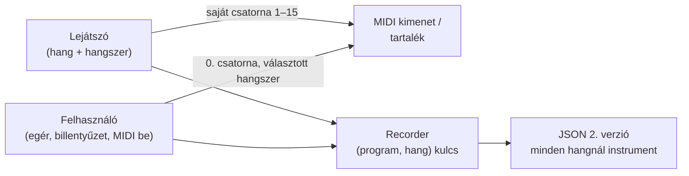

# TASK-019 — Rájátszás: a felvétel mindent rögzít, 2. verziójú formátum

**Állapot:** kész · 2026-10-22

## Működés

- Ha felvétel közben egy felvétel szól, **minden bekerül, ami hallható**: a visszajátszott hangok a saját hangszerükkel, a felhasználó hangjai (egér, billentyűzet, MIDI bemenet) a választott hangszerrel. Lejátszás közben indított felvételbe a már szóló hangok is bekerülnek (a felvétel 0. pillanatától).
- Felvétel közben hangszert váltva a további hangok az új hangszerrel rögzülnek; a lenyomva tartott billentyű váltáskor sem marad lógva.
- **2. verzió:** minden hangnak saját `instrument` mezője van (`name`, `program`). Az **1. verzió** (régi felvételek, daloskönyv) változatlanul tölthető és játszható.
- Lejátszáskor egy 2. verziójú felvétel minden hangszere **saját MIDI csatornán** szól egyszerre (1–15, a 10. dobcsatorna kihagyva); a felhasználó hangszere a 0. csatornán marad, így rá lehet játszani. Az 1. verzió a régi módon szól: a fő csatornán, átállítható hangszerrel.
- A **Felvételek…** ablak a hangszer oszlopban a felvétel összes hangszerét mutatja.

## Ellenőrzés

- +11 unit teszt: 2. verzió alakja, mentés / betöltés / listázás / törlés, 1. verzió kompatibilitás, verziófüggő hang-alak ellenőrzés, keverés (lejátszás + felhasználó, azonos hang két hangszeren), hangszerváltás felvétel közben, hangszerenkénti ütemezés, csatornakiosztás, csatornánkénti hangok a hanggenerátorban, csatornák a MIDI kimeneten (program, pedál, vészleállítás).
- Valós ablak: 14/14 — fuvola (1. csatorna) és vonósok (2.) egyszerre szólnak, a választott zongora nem változik; lejátszás közben indított felvétel rájátszással: a felvétel fuvolát, vonósokat és zongorát tartalmaz; visszajátszva három csatornán szól; az 1. verzió csak a fő csatornán szól és beállítja a hangszert; hangszerváltás felvétel közben.
