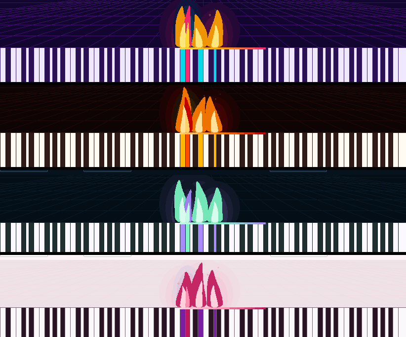

# TASK-020 — Lángoló hangeffekt

**Állapot:** kész · 2026-10-22

## Működés

- Minden szóló hang **lángot gyújt** a billentyűje fölött a korábbi neon oszlop és apró szikrák helyett:
  - **fényudvar** — három, egyre halványabb ellipszis réteg: puha izzás a láng körül,
  - **lángnyelv** — simított sokszög, alul széles, a csúcs felé keskenyedik és saját ritmusában leng / lobog,
  - **mag** — világosabb, kisebb láng a belsejében,
  - **parázs** — gyújtáskor kipattan, amíg a hang szól, folyamatosan száll fel a csúcsról (a láng mögött rajzolva, így csak a csúcs fölött látszik).
- A hangerő a láng magasságát és fényét adja; gyújtáskor 80 ms alatt felcsap, elengedéskor ~0,5 mp alatt összehúzódik és kialszik.
- A színek a skin „nap” színátmenetéből jönnek, így minden skinnek saját lángja van; a fekete billentyűk lángja más árnyalatú.

## Teljesítmény

- Korlátok: legfeljebb 40 láng és 70 parázs; a vászon elemei újrahasznosítva (rétegenkénti készlet), a rétegek sorrendje csak új elem létrehozásakor áll helyre.
- Mérés valós ablakban, 10 egyszerre szóló hanggal: átlag **3,1 ms** / képkocka (legfeljebb 6,6 ms), ~26 képkocka / mp.

## Ellenőrzés

- 15 unit teszt a láng modellre (rétegek sorrendje, billentyűhöz igazítás, felcsapás + lobogás, mag a lángon belül, hangerő → magasság és fény, parázs kibocsátás és felszállás, kialvás, újragyújtás, korlátok).
- Valós ablak: 13/13 — 4 láng + 4 mag + 12 fényudvar réteg, simított sokszögek, helyes rétegsorrend, skin színek négy skinnél, képkocka költség, kialvás után az animáció leáll, az Effekt kikapcsolás azonnal eltünteti.
