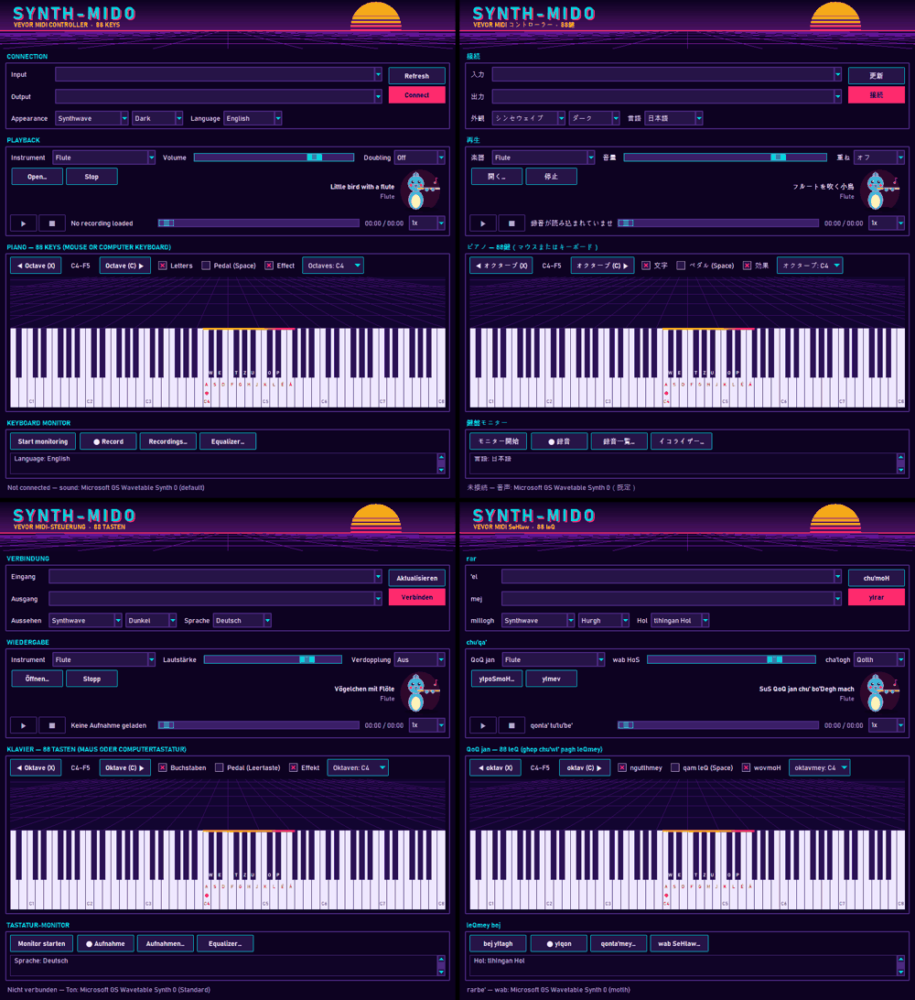
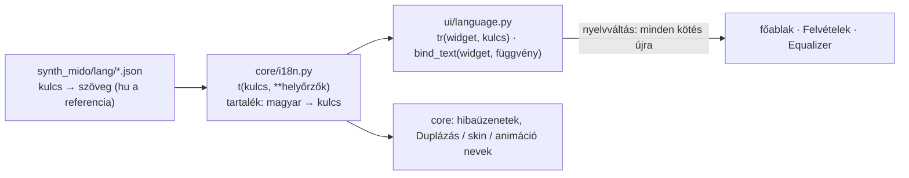

# TASK-021 — Nyelvválasztó: 9 nyelv

**Állapot:** kész · 2026-10-22

## Működés

- A **Csatlakozás** részben, a Megjelenés mellett: **Nyelv** lista — Magyar, English, Français, 日本語, Deutsch, Svenska, Suomi, Español, tlhIngan Hol.
- Váltáskor az egész nyelv újratöltődik, és **azonnal** átíródik minden: szakaszcímek, gombok, feliratok, a fejléc alcíme, a listák (skinek, Sötét / Világos / Rendszer, Duplázás), az állapotsor, a lejátszó sáv, a hangszer illusztráció felirata, a nyitott **Felvételek** és **Equalizer** ablak, a párbeszédek és a hibaüzenetek (a felvétel ellenőrzés hibái is). A napló új sorai már az új nyelven jönnek.
- A választás mentődik, újraindításkor a program a választott nyelven indul.
- A klingon helyesírásban a kis- és nagybetű más hangot jelöl, ezért klingonul a szakaszcímek és a fejléc nem kerülnek nagybetűsre.

## Felépítés

- Egy nyelv = egy lapos JSON fájl (`{"btn.save": "Mentés", …}`), így később könnyen adatbázisba költöztethető.
- A nyelvfüggő listákból (skin, változat, Duplázás, animáció) **index szerint** választunk, nem a felirat alapján — így bármely nyelven működnek.
- A hangszerek General MIDI nevei (pl. *Acoustic Grand Piano*) minden nyelven angolul maradnak.

## Ellenőrzés

- 13 új unit teszt: mind a 9 nyelv elérhető a saját nevén, minden fájl lapos kulcs–érték JSON, **minden nyelvben pontosan a referencia kulcsai** és **ugyanazok a helyőrzők**, a kódban használt minden kulcs létezik, a generált kulcsok (skinek, módok, animációk) megvannak, váltás és újratöltés, tartalékok, hibás helyőrző nem omlik össze, a felvétel hibaüzenetei is fordulnak, klingonul nincs nagybetűsítés.
- Valós ablak: 18/18 — magyarul indul, 9 nyelv a listában; angolra váltva nem marad magyar felirat a főablakban, a nyitott Felvételek (cím, oszlopfejlécek, gombok) és Equalizer (cím, animáció nevek) ablak is átíródik; listák, állapotsor, lejátszó, Oktávok felirat, illusztráció felirat, szakaszcímek; a választás index szerint működik; **mind a 9 nyelv elfér 780 px szélességben** (a japán feliratokat ehhez rövidítettem); a felvétel gomb és számláló németül; újraindítás után japánul indul.
- A korábbi füstpróbák (017, 018, 019, 020, 022) változatlanul zöldek.
