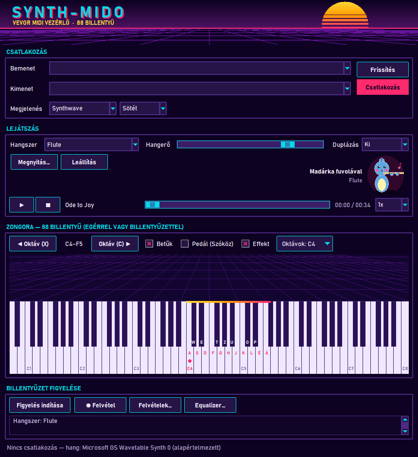
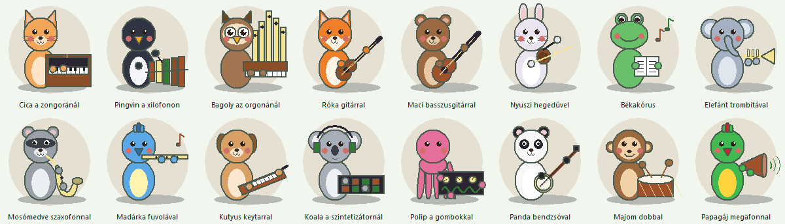

# TASK-022 — Hangszer illusztráció a Lejátszás részben

**Állapot:** kész · 2026-10-22

## Működés

- A **Lejátszás** részben, a Megnyitás… / Leállítás gombok mellett egy cuki állat játszik a választott hangszeren, mellette felirat (pl. *Madárka fuvolával* · Flute).
- A General MIDI 128 hangszere 16 családba tartozik; mindegyik család saját, előre megrajzolt állatot és hangszert kap:

| Család | Állat + hangszer | Család | Állat + hangszer |
|---|---|---|---|
| Zongorák | cica + zongora | Nádnyelvesek | mosómedve + szaxofon |
| Kromatikus ütősök | pingvin + xilofon | Sípok, fuvolák | madárka + fuvola |
| Orgonák | bagoly + orgona | Szinti szóló | kutyus + keytar |
| Gitárok | róka + gitár | Szinti pad | koala + fejhallgató, pad |
| Basszusok | maci + basszusgitár | Szinti effektek | polip + gombok, hullám |
| Vonósok | nyuszi + hegedű | Népi hangszerek | panda + bendzsó |
| Együttesek, kórus | béka + kotta | Ütősök | majom + dob |
| Rezek | elefánt + trombita | Hangeffektek | papagáj + megafon |

- A rajz csak vászon primitívekből áll (nincs képfájl), egy egységnyi dobozban készül és méretezhető; a hangszerek és a háttér színei a skinből jönnek.
- Hangszerváltáskor, felvétel betöltésekor (ha az beállítja a hangszert) és skinváltáskor újrarajzolódik.

## Ellenőrzés

- 7 unit teszt: 16 család különböző állattal és hangszerrel, mind a 128 hangszer rajzhoz és felirathoz tartozik, példák (fuvola → madárka), minden jelenet a dobozán belül rajzol mind a 34 megjelenésben, méretezés, skin színek.
- Valós ablak: 7/7 — alapból cica a zongoránál; fuvola, hegedű, taiko váltás; egy felvétel betöltése (Ode to Joy → String Ensemble) békakórusra vált; 780 × 800-as ablakban mind a 34 megjelenésnél elfér, nem takarja a gombokat, az állapotsor és a napló látható.
