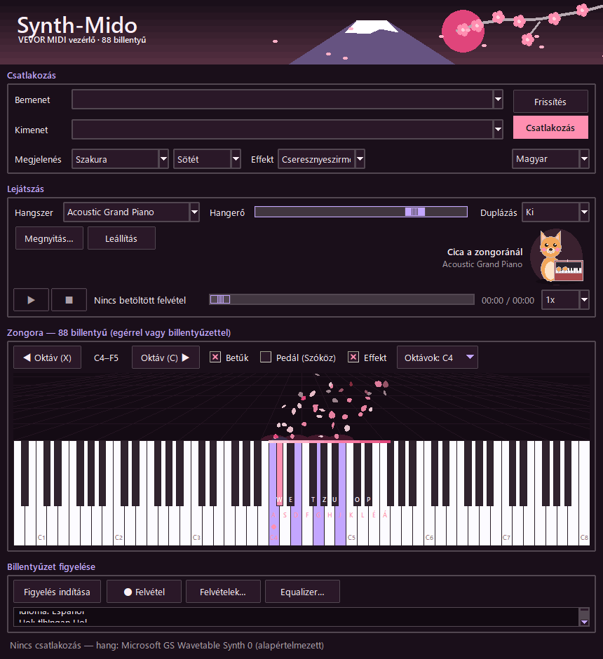
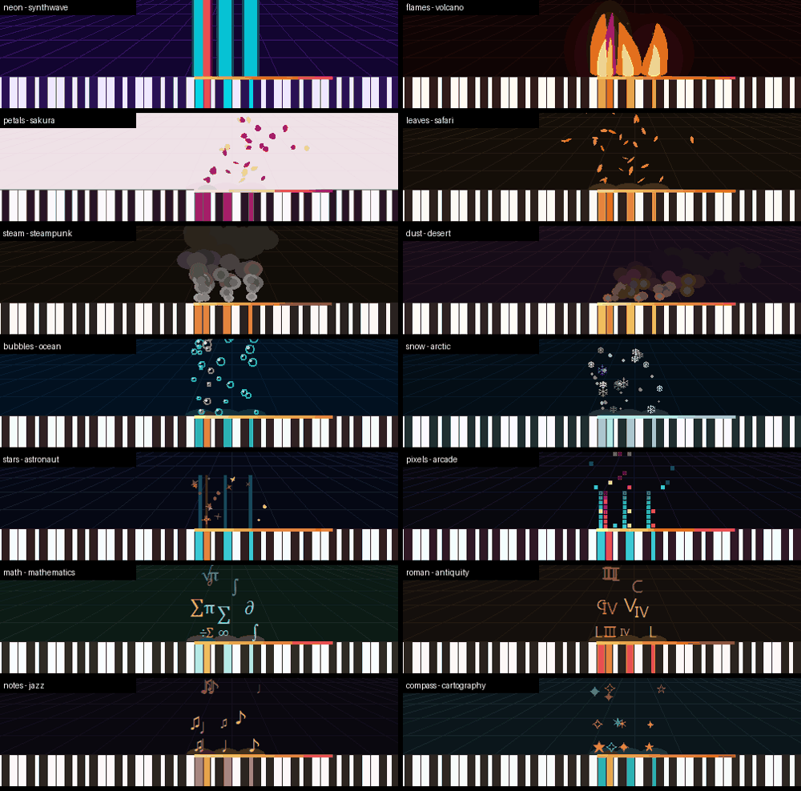
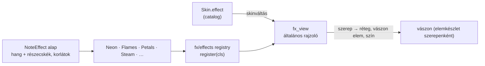

# TASK-023 — Választható, skinhez illő hangeffektek

**Állapot:** kész · 2026-10-22

## Működés

- A **Csatlakozás** részben, a Megjelenés mellett új **Effekt** lista (a nyelvválasztó a Frissítés / Csatlakozás gombok alá került, hogy a sor elférjen).
- **Skinváltáskor** az effekt a skinhez illőre vált: Vulkán → lángok, Szakura → cseresznyeszirmok, Steampunk → gőz, és így mind a 17 skinnél. Kézzel bármelyik választható; sötét / világos váltáskor megmarad, a választás mentődik.
- A már szóló hangok effektváltáskor az új effekttel folytatódnak; az **Effekt** jelölő továbbra is ki- és bekapcsolja.

| Effekt | Mit csinál | Skin |
|---|---|---|
| neon | neon oszlop nő a billentyűből, leválik, szikrák | Synthwave, Klasszikus |
| flames | háromrétegű fényudvar, lobogó láng, parázs | Vulkán |
| petals | rovátkolt szirmok, lassan (3 mp) elsodródnak jobbra, imbolyognak és pörögnek | Szakura |
| leaves | zöld és arany levelek sodródnak | Erdő, Szafari |
| steam | lenyomáskor „pfff” — sűrű, táguló gőz, amíg szól, folyamatos pára | Steampunk |
| dust | a szél oldalra fújja a homokport | Sivatag |
| bubbles | imbolygó buborékok csillanással | Óceán |
| snow | pislákoló hópelyhek (❄) és pöttyök | Sarkvidék |
| stars | forgó, pislákoló csillagok fénycsíkkal | Űrhajós, Art Deco |
| pixels | 8 bites oszlop és rácsra illesztett, lépcsőzetesen ugráló pixelek | Arcade |
| math / roman / notes / compass | felszálló jelek: π ∑ √ · Ⅰ Ⅴ Ⅹ · ♪ ♫ · ✦ ★ | Matematika, Ókor, Jazz klub, Térkép |

## Felépítés (könnyen bővíthető)

- Az effekt csak **szerepeket** ad: réteg sorrend (`LAYERS`), vászon elem fajta (`KINDS`: poly / oval / rect / ring / text), szín a palettából (`colors`), és alakzatokat (`voice_shapes`, `spawn`, `particle_shapes`). A közös alap kezeli a hangokat, a részecske kibocsátást, az elengedést és a korlátokat.
- Új effekt = egy alosztály + `register` + `fx.<id>` név a nyelvi fájlokban + a skin `effect` mezője. A felülethez nem kell nyúlni.
- A jeles effektek (❄, ♪, π …) betűtípusát a felület előre betölti a látható területen kívül, így az első megjelenés sem akad meg (korábban akár 106 ms).

## Ellenőrzés

- 21 unit teszt: 14 regisztrált effekt, mind a 17 skin létező effektet nevez meg, ismeretlen azonosító / dupla regisztráció, név minden nyelven, szerepek és színek minden skinben; **minden effektre** közösen: üresjáratban nem rajzol, érvényes alakzatok rétegsorrendben, elengedés után kialszik, korlátok, a szóló hang megmarad, billentyűzeten kívüli hang; láng, neon, szirom (felfelé és jobbra sodródik, lassan, simított rovátkolt sokszög), gőz (emelkedik, tágul, ritkul; amíg szól, gőzöl), jelkészletek, pixel rács.
- Valós ablak: 16/16 — Synthwave → neon, Szakura → szirmok, Steampunk → gőz, Vulkán → lángok, Sarkvidék → hó; a kézi választás megmarad sötét / világos váltáskor, skinváltáskor a skinhez illőre áll; a lenyomott hang átkerül az új effektbe; újraindítás után a választott effekt; a sor 9 nyelven elfér 780 px-en.
- Képkocka költség 10 lenyomott hanggal (átlag / legrosszabb): neon 1,0 / 2,9 ms, lángok 2,7 / 4,0, szirmok 2,3 / 7,8, gőz 3,5 / 17,3, hó 5,5 / 15,8, jelek 3,7–4,6 / 10–26 ms.
