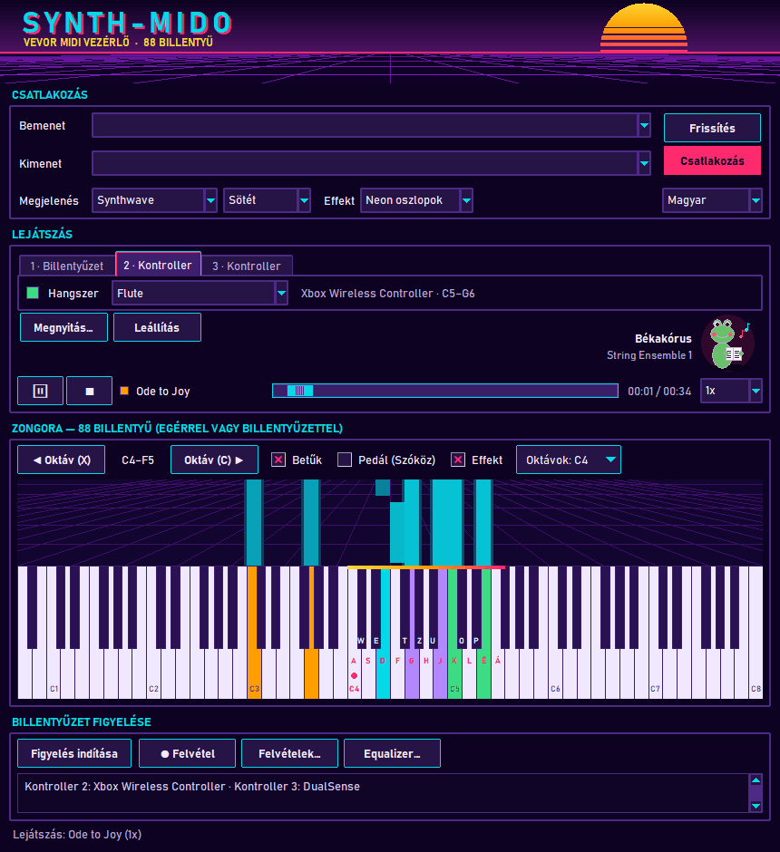

# TASK-024 — Játékvezérlők mint további hangszerek, forrásonkénti billentyű színek

**Állapot:** kész · 2026-10-22

## Működés

- A **Lejátszás** rész hangszer sora **fülekre** bomlik:
  - **1 · Billentyűzet** — az eddigi hangszer, hangerő és duplázás (egér, számítógép billentyűzet, MIDI zongora);
  - **2 · Kontroller** — mindig látszik; vezérlő nélkül a hangszer lista le van tiltva, és „Nincs csatlakoztatott játékvezérlő” felirat jelzi;
  - **3 · Kontroller, 4 · …** — minden további csatlakoztatott vezérlőhöz megjelenik egy fül, kihúzáskor eltűnik.
- A program 2 másodpercenként keresi a vezérlőket (USB és Bluetooth, **ki- és bedugás menet közben is**), a csatlakoztatottak állapotát másodpercenként ~60-szor olvassa. Windowson a beépített joystick API-t használja (nincs új függőség).
- Minden fül **saját hangszert** választ; a vezérlő hangjai saját MIDI csatornán (15, 14, 13, 12) szólnak, így a billentyűzettel és egy lejátszott felvétellel egyszerre, más-más hangszínnel lehet zenélni.

| Vezérlő | Mit csinál |
|---|---|
| 12 gomb | a dúr skála fokai a kiinduló hangtól (alapból C4–G5) |
| D-pad ↑ / ↓ | oktáv fel / le (a 88 billentyűn belül) |
| D-pad ← / → | hangnem egy félhanggal le / fel |
| bal kar fel / le | hangerő (közép: 100, fel: 127, le: halkabb) |
| ravasz (Z tengely) | kitartó pedál a vezérlő saját hangjaira |

- A fül felirata mutatja a vezérlő nevét és az elérhető tartományt (pl. *Xbox Wireless Controller · C5–G6*); csatlakozáskor a napló kiírja a gombkiosztást.
- A felvétel a vezérlők hangjait is rögzíti a saját hangszerükkel (2. verziójú felvétel), az effektek és az equalizer is reagálnak rájuk.

## Színek

- Minden hangforrás **saját színnel** világítja a billentyűket: billentyűzet / egér / MIDI zongora (a skin kiemelő színe), **lejátszás** (külön szín, minden skinben eltér az élő játéktól), és vezérlőnként egy-egy szín.
- Ha többen nyomják ugyanazt a billentyűt, a legutóbbi színe látszik, és addig világít, amíg bárki tartja.
- A színek a skin palettájából és egy élénk tartalék listából jönnek úgy, hogy minden forrás legalább 80 egységnyi RGB távolságra legyen a többitől és a billentyűk alapszínétől — mind a 34 megjelenésben. A fülekben és a lejátszó sávban kis színminta mutatja, melyik szín kié.

## Javítás: kis ablak

A legkisebb ablakméretnél (780 × 800) a **Billentyűzet figyelése** rész (Felvétel, Felvételek…, Equalizer… gombok) eddig kilógott az ablakból — a korábbi ellenőrzések elavult méreteket olvastak, ezért nem vették észre. Most ez a rész mindig kap helyet; kis ablakban az effekt sáv és a billentyűk arányosan alacsonyabbak lesznek (a billentyűk a valódi magasságukban rajzolódnak, nem levágva).

## Ellenőrzés

- 19 új unit teszt hamis vezérlő backenddel: a gombok a skála hangjai, lenyomás / felengedés párok, D-pad egyszer lép, oktáv a billentyűzeten belül, váltás lenyomott gombnál nem hagy lógó hangot, kar → hangerő, ravasz → pedál, mindent felenged; a 2. fül mindig látszik, hot-plug és stabil sorszám, legfeljebb 4 vezérlő, kihúzás, a vezérlő csatornák nem ütköznek a felvételekével; billentyű forrás verem; minden forrás külön és látható szín minden skinben, a lejátszás eltér az élő játéktól.
- Valós ablak (hamis vezérlőkkel): 24/24 — fülek vezérlő nélkül, bedugás → engedélyezett fül névvel és tartománnyal, hangszer → program a 15. csatornán, gomb → C4 a 15. csatornán a vezérlő színével, az effekt is reagál, a billentyűzet átveszi és visszaadja a színt, második vezérlő → 3. fül saját csatornával és színnel, pedál tartja és elengedi, D-pad oktáv, felvétel a vezérlő hangszerével, lejátszás színe, kihúzás → fül eltűnik és nincs beragadt hang, angol feliratok, minden nyelven elfér 780 × 800-ban (a Felvétel gomb az állapotsor fölött, a billentyűk legalább 60 px).
- **Valódi vezérlővel nem tudtam kipróbálni** (ezen a gépen nincs csatlakoztatva); a Windows joystick API elérhető és üres listát ad.
