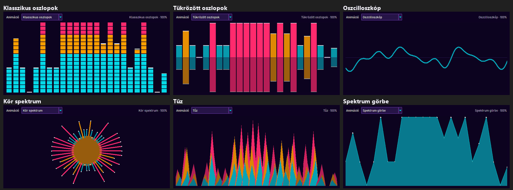

## Install
### Windows
download and install
https://visualstudio.microsoft.com/downloads/#build-tools-for-visual-studio-2022

Build Tools for Visual Studio 2026 -- direct link: https://aka.ms/vs/stable/vs_BuildTools.exe

>pip install -r requirements.txt

### Linux

pip install  -r requirements.txt

## Run

>py main.py

A program egy egyszerű ablakos felületet nyit: MIDI eszközök csatlakoztatása, hangszer választás, skála/akkord/bemutató, kattintható 88 billentyűs zongora (A0–C8, a C-k feliratozva, a középső C kiemelve) és billentyűzet-figyelés.

A haladás képernyőképekkel a [progress](progress/README.md) mappában követhető.

## Zongorázás a billentyűzettel

A zongora a számítógép billentyűzetéről is játszható (MIDI eszköz nélkül is), a zenei programokban megszokott két sorral:

```
   W   E       T   Z/Y  U       O   P
 A   S   D   F   G    H   J   K   L   É/;  Á/'
 C4  D4  E4  F4  G4   A4  B4  C5  D5  E5   F5
```

- Magyar QWERTZ és amerikai QWERTY kiosztáson is ugyanazokon a fizikai gombokon szól (a Z és Y is a G#).
- Több gomb együtt lenyomva akkordot ad; a lenyomva tartott gomb nem ismétel.
- A hangerő a "Hangerő" csúszkából jön; futó felvétel a billentyűzettel játszott hangokat is rögzíti.
- Szövegmezőben és Ctrl / Alt kombinációkkal nem szól; ha az ablak elveszti a fókuszt, minden lenyomott hang elhallgat.
- **X** egy oktávval lejjebb, **C** egy oktávval feljebb tolja a tartományt (vagy a zongora feletti ◀ / ▶ gombok); így az A0-tól a C8-ig minden billentyű elérhető. A kék sáv a zongora tetején mutatja az elérhető tartományt, a "Betűk a billentyűkön" kapcsolóval a gombok betűi is megjelennek.
- **Duplázás** ("két kéz", a "Lejátszás" sorban): Ki / +1 oktáv / −1 oktáv / ±1 oktáv — minden egérrel vagy billentyűzettel játszott hang egy oktávval lejjebb és/vagy feljebb is megszól, a felvétel is így rögzíti. A MIDI bemenet és a visszajátszás nem duplázódik. A választás mentődik.
- **Oktávok ▾** (a zongora feletti sorban): alapból csak a billentyűzet oktávja (X / C) van bejelölve; további oktávokat bejelölve minden egérrel / billentyűzettel játszott hang az összes bejelölt oktávban szól (pl. C2 · C4 · C6). A Duplázással és a pedállal együtt is működik, a felvétel minden hangot rögzít.
- **Szóköz** = kitartó pedál: amíg lenyomva tartod, az elengedett billentyűk tovább szólnak (MIDI eszközre CC 64-ként megy ki, a tartalék kimeneten is működik). A "Pedál (Szóköz)" kapcsolóval egérrel is rögzíthető. A felvétel a ténylegesen szóló hosszt rögzíti.

## Hang MIDI eszköz nélkül

Ha nincs csatlakoztatott MIDI kimenet, a program a gép alapértelmezett hangkimenetét használja, így a képernyős zongora és a felvételek visszajátszása eszköz nélkül is hallható:

- **Windows:** a beépített *Microsoft GS Wavetable Synth* szól, a hangszerválasztás is működik.
- **Linux / macOS:** ha fut egy szoftveres szintetizátor (FluidSynth, TiMidity), annak a portját használja; különben egy egyszerű beépített hanggenerátor szól az alapértelmezett hangeszközön (`numpy` + `sounddevice`). Ez minden hangszert ugyanúgy szólaltat meg. Linuxon a `sounddevice`-hoz a PortAudio rendszercsomag kell (pl. `sudo apt install libportaudio2`).

Csatlakoztatott MIDI kimenet esetén mindig az szól; leválasztás után a program visszavált az alapértelmezett kimenetre. Az aktív hangkimenet az állapotsorban látható. Ha egyik kimenet sem érhető el, a program hang nélkül is működik (egyszer jelzi a naplóban).

Tesztek: `python -m unittest tests.test_audio_output -v`

## Megjelenés (skinek)

A "Megjelenés" sorban két választó van: a **skin** és a **változat** (Sötét / Világos / Rendszer — a Rendszer az operációs rendszer beállítását követi, futás közben is). Alapértelmezés: **Synthwave, sötét**.

17 skin, mindegyik sötét és világos változattal: Synthwave, Klasszikus, Űrhajós, Szafari, Térkép, Matematika, Ókor, Óceán, Erdő, Szakura, Steampunk, Arcade, Art Deco, Sivatag, Sarkvidék, Vulkán, Jazz klub. Mindegyiknek saját színpalettája, betűtípusa, rajzolt fejléc jelenete és widget stílusa van (gombok alakja, kerete, minden állapot színe, csúszkák, jelölőnégyzetek, legördülők, ablakok, zongora, effekt). Minden szöveg / háttér pár legalább 4.5 : 1 kontrasztú.

A választás a felhasználói konfigurációs mappába mentődik (`%APPDATA%\synth-mido\settings.json`, illetve `~/.config/synth-mido/settings.json`).


Új skin: paletta `make_palette`-tel és fejléc rajzoló a `synth_mido/skins/painters.py`-ba, majd egy `register(Skin(...))` a `synth_mido/skins/catalog.py`-ban.

### Hangvizualizáció

A zongora feletti sávban minden megszólaló hang **lángot gyújt** a billentyűje fölött: puha, háromrétegű fényudvar, lobogó lángnyelv világos maggal, a csúcsáról felszálló parázs. A láng magassága és fénye a hangerőtől függ; amíg a hang szól, lobog, elengedéskor összehúzódik és kialszik. A színek a skin színátmenetéből jönnek (Synthwave: magenta–narancs–sárga, Classic: kék, Arctic: menta–lila …). Minden hangforrásra reagál: egér, billentyűzet, MIDI bemenet és felvétel lejátszás. Az **Effekt** kapcsolóval ki- és bekapcsolható, a választás mentődik.

Tesztek: `python -m unittest tests.test_theme -v`

### Equalizer (Winamp-szerű)

Az **Equalizer…** gomb külön ablakot nyit spektrum analizátorral, ahogy a régi Winampban: 6 választható animáció (Klasszikus oszlopok LED szegmensekkel és lehulló csúcsokkal, Tükrözött oszlopok, Oszcilloszkóp, Kör spektrum, Tűz, Spektrum görbe). Minden megszólaló hangra reagál (egér, billentyűzet, MIDI bemenet, lejátszás, bemutató), a színeket a skinből veszi; a választott animáció mentődik.



## Hangszer illusztráció

A **Lejátszás** részben a választott hangszer családjának állata játszik a hangszerén (pl. fuvola → madárka fuvolával, trombita → elefánt, gitár → róka). A General MIDI 16 hangszercsaládja 16 különböző állatot és hangszert kap; a rajz vászon primitívekből készül (nincs képfájl), a színek a skinhez igazodnak, és hangszerváltáskor azonnal frissül.

## Felvétel

A "Billentyűzet figyelése" részben a **● Felvétel** gombbal indítható a felvétel, a **■ Leállítás** gombbal áll le. Felvétel közben látszik az eltelt idő és a rögzített hangok száma.

- Rögzül a zongora (MIDI bemenet) és a képernyős zongora minden lenyomott hangja. Ha van bemenet, a felvétel automatikusan elindítja a figyelést.
- Kapcsolat nélkül is lehet felvenni ("vakon"): ilyenkor a képernyős zongora hangjai rögzülnek hang nélkül.
- **Rájátszás:** ha felvétel közben egy felvétel szól (vagy lejátszás közben indítod a felvételt), a felvétel mindent rögzít, ami hallható: a visszajátszott hangokat a saját hangszerükkel, és amit közben te játszol, a te hangszereddel. Felvétel közben hangszert váltva a további hangok már az új hangszerrel rögzülnek.
- Leállításkor megadható a név (alapértelmezett: `felvetel_YYYYMMDD_HHMMSS`), vagy a felvétel elvethető. Leválasztáskor és kilépéskor a futó felvétel ugyanígy menthető.
- A **Felvételek…** ablak listázza az összes felvételt; egy vagy több kijelölt (Ctrl / Shift) felvétel egyszerre törölhető.

A felvételek a program mappájában, a `records/` alatt, JSON fájlként tárolódnak. Csak a hangokat, az időzítést és a hangszereket tartalmazzák. Az új felvételek **2. verziójúak**: minden hangnak saját hangszere van, így egy felvételben több hangszer szólhat egyszerre (a felső szintű `instrument` a felvétel indításakor választott hangszer):

```json
{
  "format": "synth-mido-record",
  "version": 2,
  "created": "2026-10-22T19:40:12",
  "instrument": {"name": "acoustic_grand_piano", "program": 0},
  "duration": 12.48,
  "notes": [
    {"note": 72, "velocity": 90, "start": 0.0, "duration": 1.2, "instrument": {"name": "flute", "program": 73}},
    {"note": 60, "velocity": 100, "start": 0.5, "duration": 0.42, "instrument": {"name": "acoustic_grand_piano", "program": 0}}
  ]
}
```

Az **1. verziójú** felvételek (a korábbiak és a daloskönyv) továbbra is betölthetők: ott a hangoknak nincs `instrument` mezője, a felvétel hangszere egyetlen, visszajátszáskor átállítható alapértelmezés. `start` és `duration` másodpercben értendő. Tesztek: `python -m unittest tests.test_recorder -v`

## Daloskönyv

A `records/` mappában 18 közismert, **közkincs** mű található felvételként, azonnal lejátszható (Felvételek… ablak vagy Megnyitás…):

| Mű | Szerző | Év | Hangszer | Hossz | Hangok |
|---|---|---|---|---|---|
| Für Elise | Ludwig van Beethoven | 1810 | Acoustic Grand Piano | 00:35 | 188 |
| Ode to Joy | Ludwig van Beethoven | 1824 | String Ensemble 1 | 00:34 | 106 |
| Twinkle Twinkle Little Star | népdal (Mozart variációk) | 1761 | Music Box | 00:28 | 66 |
| Rondo alla Turca | Wolfgang Amadeus Mozart | 1783 | Acoustic Grand Piano | 00:15 | 170 |
| In the Hall of the Mountain King | Edvard Grieg | 1875 | Pizzicato Strings | 00:32 | 210 |
| Canon in D | Johann Pachelbel | 1680 | String Ensemble 1 | 01:16 | 172 |
| Funeral March | Frédéric Chopin | 1839 | Acoustic Grand Piano | 00:23 | 58 |
| William Tell Overture - Finale | Gioachino Rossini | 1829 | Brass Section | 00:07 | 83 |
| Minuet in G | Christian Petzold | 1725 | Harpsichord | 00:24 | 91 |
| Morning Mood | Edvard Grieg | 1875 | Flute | 00:17 | 66 |
| Brahms Lullaby | Johannes Brahms | 1868 | Music Box | 00:16 | 43 |
| Jingle Bells | James Lord Pierpont | 1857 | Acoustic Grand Piano | 00:29 | 82 |
| Greensleeves | népdal (angol) | 1580 | Acoustic Guitar Nylon | 00:19 | 70 |
| Eine kleine Nachtmusik | Wolfgang Amadeus Mozart | 1787 | String Ensemble 1 | 00:14 | 69 |
| The Entertainer | Scott Joplin | 1902 | Honky Tonk Piano | 00:10 | 93 |
| Gymnopédie No. 1 | Erik Satie | 1888 | Electric Piano 1 | 00:25 | 50 |
| Toccata and Fugue in D minor | Johann Sebastian Bach | 1705 | Church Organ | 00:27 | 41 |
| Moonlight Sonata | Ludwig van Beethoven | 1801 | Acoustic Grand Piano | 00:22 | 72 |

Modern, szerzői jogvédett művek (pl. Imperial March) nincsenek benne. A dalok forrása a `synth_mido/core/songbook.py` tömör jelöléssel; újragenerálás: `python -m scripts.build_songbook`.

## Visszajátszás

Egy mentett felvétel kétféleképpen játszható le:

- a "Lejátszás" részben a **Felvétel lejátszása…** gombbal: fájlválasztó nyílik a `records/` mappában;
- a **Felvételek…** ablakban: jelölj ki egy felvételt és nyomd meg a **Lejátszás** gombot (vagy kattints duplán / Enter).

Egy 2. verziójú felvétel minden hangszere egyszerre, a saját hangszínén szól (mindegyik külön MIDI csatornán), a "Hangszer" lista pedig a tiéd marad: lejátszás közben azzal játszhatsz rá. Egy 1. verziójú felvétel betöltésekor a felvétel hangszere lesz kiválasztva a "Hangszer" listában, de lejátszás előtt vagy közben bármikor átállítható. A hangok az eredeti időzítéssel és hangerővel szólnak, a lejátszott billentyűk kiemelve látszanak a képernyős zongorán. MIDI eszköz nélkül az alapértelmezett hangkimeneten szól (lásd fent). A **Leállítás** gomb azonnal megállítja, és minden szóló hangot elhallgattat; új felvétel lejátszása leállítja az előzőt. Egy éppen futó felvételbe a visszajátszás is bekerül (lásd Rájátszás).

### Lejátszó vezérlők

A betöltött felvétel a "Lejátszás" rész alsó sorában vezérelhető:

- **▶ / ⏸** — lejátszás és szünet; szünetben a hangok elhallgatnak, folytatáskor ugyanonnan szól tovább (a közben szóló hangok újraindulnak). A végére érve az elejéről indul újra.
- **■** — leállítás és visszatekerés az elejére (a felvétel betöltve marad). A **Leállítás** gomb ugyanígy működik, és minden szóló hangot is elhallgattat.
- **Pozíció csúszka** — mutatja, hol tart a lejátszás (`perc:mp / hossz`); rákattintva vagy húzva oda ugrik, lejátszás közben és szünetben is.
- **Sebesség** — 0.5x … 2x, lejátszás közben is azonnal vált, ugrás nélkül.

Tesztek: `python -m unittest tests.test_playback -v`

## Projekt felépítés

```
main.py                 belépési pont
synth_mido/
  config.py             MIDI csatorna, eszköz kulcsszavak, hangszerek
  core/                 Tk-tól független modellek (unit tesztelhetők)
    events.py           NoteBus — Observer: minden hang forrással együtt
    recorder.py         felvétel + JSON tárolás
    playback.py         lejátszó (szünet, ugrás, sebesség)
    piano_layout.py     88 billentyű geometria
    keyboard_play.py    számítógép billentyűzet, oktávváltás, pedál gomb
    sustain.py          kitartó pedál
    doubling.py         oktáv duplázás
  audio/                MIDI kimenet / bemenet és tartalék hanggenerátor
  skins/                témák / skinek (paletták, fejléc rajzolók)
  fx/                   vizuális effektek: lángok, spektrum, equalizer animációk, hangszer illusztrációk
  ui/                   Tk felület: app.py összerakja a részeket (mixinek)
tests/                  unit tesztek (+ fakes.py: közös hamis időzítő / port)
scripts/                hardver / diagnosztikai szkriptek (valódi eszközt igényelnek)
records/                felvételek (JSON)
progress/               haladás képernyőképekkel
```

Tervezési minták: **Observer** (`core/events.py` NoteBus — a zongora kiemelés, a hangvizualizáció és a hangszínszabályzó ablak feliratkozik a hangokra), **Facade** (`audio/midi_controller.py` — egy kimenet a csatlakoztatott eszköz vagy a tartalék előtt), **Strategy + Registry** (skinek fejléc rajzolói és az effekt animációk), Tk-tól független modellek + vékony nézet réteg.

Diagnosztika: `python -m scripts.examples`, `python scripts/diag.py`, `python scripts/midi_check.py`.

## Fejlesztés: pre-commit

Minden `git commit` előtt lefut a minőségkapu (`.pre-commit-config.yaml`): alap fájlellenőrzések, `ruff` lint és a `tests/` mappa összes unit tesztje (`python -m unittest discover -s tests -t .`). Egyszeri beállítás:

>pip install -r requirements-dev.txt
>pre-commit install

Kézi futtatás az összes fájlon: `pre-commit run --all-files`
